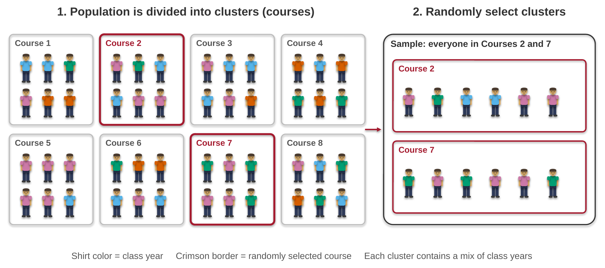
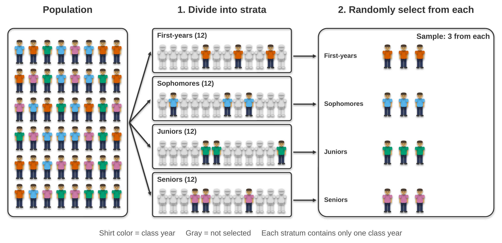
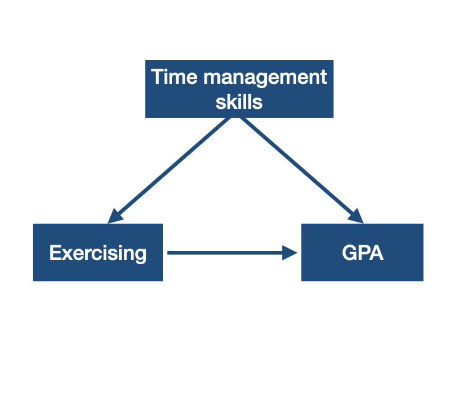
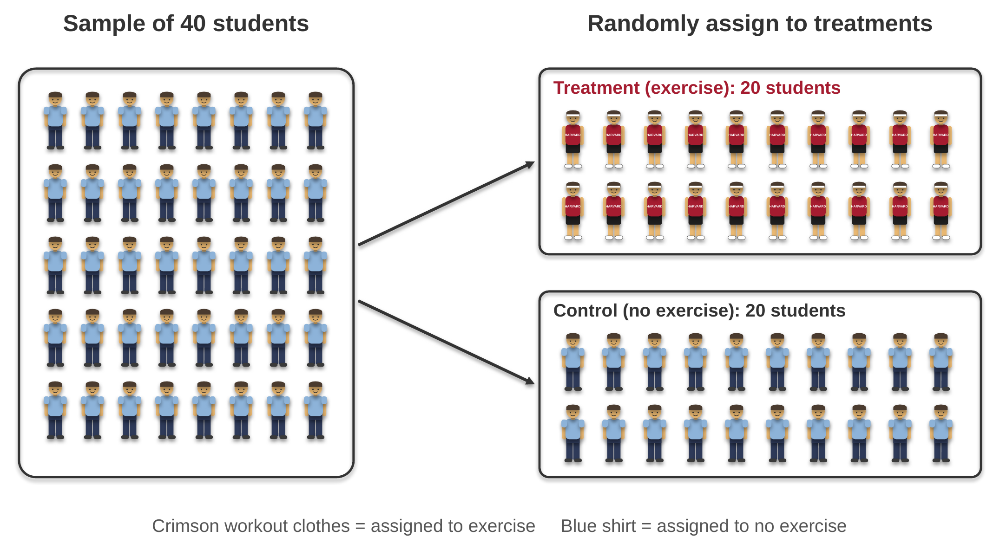
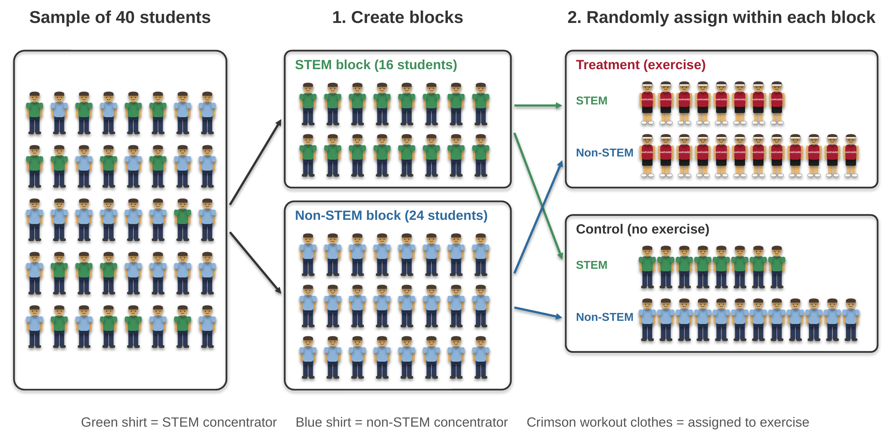
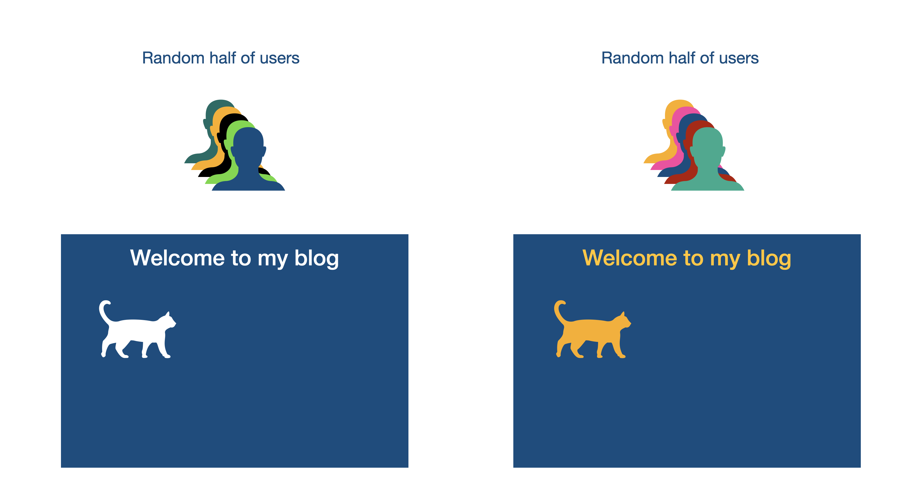

```{r}
#| echo: false
#| message: false
library(tidyverse)
options(scipen = 999)
```

# Sampling {.inverse background-color="#A51C30"}

## Research question

Every research project aims to answer a research question (or multiple questions).

::: {.stat-callout .example}
**Example**

Do Harvard students who exercise regularly have higher GPA?
:::

We will use this research question throughout the examples in the lecture.

## Population

Each research question aims to examine a __population__.

::: {.stat-callout .example}
**Example**

Population for this research question is Harvard students.
:::

## Data Collection

Data are collected to answer research questions.
There are different methods to collect data.
For instance, data can be collected

- in-person or online (if collecting from human subjects)
- on-site or off-site (e.g. rainfall measures vs. moon image tracking)
- with different tools such as surveys, motion sensors (e.g. marathon finish lines)

## Data Collection - Ethics

When collecting data from human and animal research subjects we need to consider ethics.

In universities, rights of the human and animal research subjects are protected by the Institutional Review Board (IRB) of each university.
If interested (highly recommended) you can read about Harvard's IRB, the [Committee on the Use of Human Subjects](https://cuhs.harvard.edu/).

##

::: {.stat-callout .example}
**Example**

Consider that we design a survey with the following questions to study the research question.

- Do you exercise at least once every week?

- What is your GPA?
:::

## Sampling

A population is a collection of elements which the research question aims to study.
However it is often costly and sometimes impossible to study the whole population.
Often a subset of the population is selected to be studied.
__Sample__ is the subset of the population that is studied.
The goal is to have a sample that is __representative__ of the population so that the findings of the study can generalize to the population.

##

::: {.stat-callout .example}
**Example**

Since it would be almost impossible to give the survey to ALL Harvard students, we can give it to a sample of students.
:::

There are different sampling methods to consider.

## Notation

<table align ="center">

<thead>
<th> </th>
<th>Sample Statistic</th>
<th>Population Parameter</th>
</thead>

<tr>
<td>Mean</td>
<td> x&#772; </td>
<td> &mu;</td>

</tr>

<tr>
<td> Standard Deviation </td>
<td> s </td>
<td> &sigma;</td>

</tr>

<tr>
<td> Variance </td>
<td> s<sup>2</sup> </td>
<td> &sigma;<sup>2</sup></td>

</tr>

<tr> 
<td>Proportion</td>
<td>p</td>
<td>&pi;</td>

</tr>


</table>

Starting next class, we will learn how to use sample data to estimate the population parameter.

## Convenience (Availability) Sampling

Convenience sampling occurs when a specific sample is selected because the sample is easy to access.

::: {.stat-callout .example}
**Example**

- Stand on the steps of Widener Library
- Give the survey to 100 Harvard students
:::

## Sampling bias 

This could introduce (sampling) __bias__ and the findings may not generalize to the population. It is possible that those in front of the library

- may study more and thus may have higher GPA.
- may be more active than those who study in their dorm or house.


## Simple Random Sample

When simple random sampling technique is used any element of the population has an equal chance of being selected to the sample.

::: {.stat-callout .example}
**Example**

The researcher can

- reach out to the registrar to get student emails;
- randomly select 100 students;
- email them the survey.
:::

## Population and sample

Assume that the 100 selected students respond.

**Population**: All Harvard students  
**Sample**: 100 students who have responded

## Simple Random Sampling in R

```{r}
sample(1:100, 3, replace = FALSE) # <1>
```

1. This allows us to sample 3 numbers from 1 to 100 without replacement, meaning a number can only be selected once.

. . .

To generalize:

```{r}
#| eval: false
sample(x = 1:N, size = n, replace = FALSE)
```

This code will take a random sample of size $n$ from the population consisting of the numbers in the interval $[1, N]$

. . .

Side note: This is not truly random but that's beyond the scope of this class. Here is a [fun (short) reading](https://engineering.mit.edu/engage/ask-an-engineer/can-a-computer-generate-a-truly-random-number/) about it. Philosophers also discuss if [true randomness exists or not](https://philosophy.stackexchange.com/questions/29364/does-true-randomness-actually-exist).

## Non-response Bias

Even when simple random sampling is used, if participants are unwilling to participate in studies then the results can have **nonresponse bias**.

::: {.stat-callout .example}
**Example**

It is unlikely that 100 students will respond. Assume that 86 respond.

It is possible that those 14 who did not respond

- may be busy exercising and did not have the time to respond.
- may be busy studying and did not have the time to respond.
:::

## Cluster Sampling

In cluster sampling the population is divided into groups (i.e., clusters). The sample consists of all elements in randomly selected clusters.

. . .

::: {.stat-callout .example}
**Example**

The researchers may get a list of courses taught at Harvard. They randomly select 10 courses. All the students in those 10 courses will be in the sample.
:::

## Cluster Sampling

```{r}
#| echo: false
#| out-width: 95%
#| fig-align: center
#| fig-alt: "Two-step diagram of cluster sampling. Step 1, 'Population is divided into clusters (courses)', shows 8 boxes labeled Course 1 to Course 8, each holding 6 figures whose shirt colors show a mix of class years. Courses 2 and 7 are outlined in crimson. Step 2, 'Randomly select clusters', shows the sample: everyone in Courses 2 and 7, 12 students with a mix of class years."

```

## Stratified Sampling

In stratified sampling the population is first divided into groups (i.e., strata) and then the sample is selected randomly within each stratum.

. . .

::: {.stat-callout .example}
**Example**

The researchers suspect that exercising patterns might be different across different class years. Thus they want to make sure that the sample includes first-years, sophomores, juniors, and seniors. They get a list of students with class year information from the registrar. They then randomly select 25 first-years, 25 sophomores, 25 juniors, and 25 seniors.
:::

## Stratified Sampling

```{r}
#| echo: false
#| out-width: 95%
#| fig-align: center
#| fig-alt: "Two-step diagram of stratified sampling. A population box holds 48 figures with four shirt colors, one per class year, mixed together. Step 1, 'Divide into strata', sorts them into four boxes of 12: first-years, sophomores, juniors, and seniors, each a single color. Within each stratum, 3 figures are in full color and 9 are grayed out. Step 2, 'Randomly select from each', shows the sample: 3 students from each class year, 12 in total."

```


# Study Design {.inverse background-color="#A51C30"}

## Anecdotal Evidence

Anecdotal evidence is an observation that is not systematic and haphazard.

. . .

::: {.stat-callout .example}
**Example**

We might meet a junior who got an A in every Harvard course they have taken, and they say that they exercise regularly. Even though the data are factually correct (i.e., high GPA and regular exercise routine), this does not tell us whether exercising regularly is related to GPA for Harvard students in general.
:::

## Anecdotal Evidence


Anecdotal evidence is not a scientific method to answer research questions. We need rigorously designed studies to make generalizations and/or to establish causal relationships.

## Observational Study

In observational studies, researchers study the research question without exposing the cases (or subset of a sample) to any treatment or intervention. In observational studies causal relationships between variables cannot be established.

::: {.stat-callout .example}
**Example**

Based on the survey, even if we observe that Harvard students who exercise regularly have higher GPA, we cannot conclude that exercising regularly increases GPA.
:::

## Relationship between two variables

If two variables are related to each other in some way we would call them __associated__.

If two variables are not related to each other in any way we would call them __independent__.

## Relationship between two variables

When we examine the relationship between two variables, we often want to know if the relationship between them is causal. In other words, does one variable cause the other? For instance, is exercising the reason for higher GPA? We don't know!

When we suspect that two variables have a causal relationship we can say

The __explanatory variable__ (e.g. exercising) might causally affect the __response variable__ (e.g. GPA).

. . .

Relationship between two variables does not imply one causes the other.

## Relationship between two variables

Explanatory variables are denoted by $x$ and the response variable is denoted by $y$. You can remember this from e**X**planatory variable is $x$. Exercising may e**X**plain high GPA.

## Confounding variable

```{r}
#| echo: false
#| out-width: 45%
#| fig-align: center
#| fig-alt: "A diagram with three dark blue boxes. A box labeled 'Time management skills' at the top has arrows pointing down to a box labeled 'Exercising' on the left and a box labeled 'GPA' on the right. An arrow also points from 'Exercising' to 'GPA'."

```

A __confounding variable__ (e.g. time management skills) is associated with both the explanatory and the response variable.

## Experiment Design

In __experiments__, researchers assign cases to treatments/interventions.

. . .

In __randomized experiments__, researchers randomly assign cases to treatments/interventions. In order to establish a causal link between variables, we need randomized experiments.

## Revised Research Question

::: {.stat-callout .example}
**Example**

~~Do Harvard students who exercise regularly have higher GPA?~~

Does exercising regularly increase GPA for Harvard students?
:::

## Randomized Experiment Design

```{r}
#| echo: false
#| out-width: 85%
#| fig-align: center
#| fig-alt: "Diagram of a randomized experiment. A box labeled 'Sample of 40 students' holds 40 figures in light blue T-shirts. Arrows under the heading 'Randomly assign to treatments' lead to two boxes: 'Treatment (exercise): 20 students', all in crimson HARVARD workout clothes, and 'Control (no exercise): 20 students', all in light blue T-shirts."

```


##

::: {.stat-callout .note-tip}
**Note**

Random sampling and random assignment (i.e., random allocation) serve different purposes.

:::: columns
::: {.column width="50%"}
### Random sampling

- method of choosing sample from the population
- the goal is to establish generalizability
:::

::: {.column width="50%"}
### Random allocation

- method of assigning the sample to different treatment groups
- the goal is to establish causality
:::
::::
:::

## Blocking

The researchers suspect that GPA may differ between students who concentrate in STEM fields and those in non-STEM fields, regardless of exercise.

. . .

If researchers suspect that an additional variable may influence the response variable, then they may use __blocks__:

1. Group the cases into blocks based on that variable (STEM vs. non-STEM).
2. Randomly assign cases to treatments *within each block*.

. . .

This way both treatment groups have a similar mix of STEM and non-STEM students, so a difference in GPA cannot be explained by concentration.

## Blocking

```{r}
#| echo: false
#| out-width: 95%
#| fig-align: center
#| fig-alt: "Three-step diagram. On the left, a box labeled 'Sample of 40 students' holds a mix of figures: 16 in green shirts (STEM concentrators) and 24 in blue shirts (non-STEM concentrators). Step 1, 'Create blocks', sorts them into a 'STEM block' of 16 and a 'Non-STEM block' of 24. Step 2, 'Randomly assign within each block', sends arrows from each block to both groups. The 'Treatment (exercise)' box has 8 STEM and 12 non-STEM students, all in crimson HARVARD workout clothes. The 'Control (no exercise)' box has 8 STEM students in green shirts and 12 non-STEM students in blue shirts."

```

## Blocking vs. stratified sampling {.smaller}

Both start by splitting people into groups based on a variable. They differ in __when__ the split happens and __why__.

| | Stratified sampling | Blocking |
|------------------|------------------------------|------------------------------|
| Stage of the study | Choosing the **sample** from the population | Assigning the sample to **treatments** |
| Groups are called | strata | blocks |
| What is random | **selection** of cases within each stratum | **assignment** of cases to treatments within each block |
| Goal | sample represents each group → **generalizability** | treatment groups are comparable on the blocking variable → **causal comparison** |
| Example | Randomly select 25 first-years, 25 sophomores, 25 juniors, and 25 seniors to survey | Within STEM and within non-STEM students, randomly assign half to exercise |

## Vocabulary

::: {.stat-callout .note-tip}
**Note**

A study can use both: stratified sampling to choose who is in the study, and blocking to decide who gets the treatment. 
:::

## Design your own randomized experiment

::: {.stat-callout .exercise}
**Exercise**

A professor wants to know whether taking notes by hand, rather than on a laptop, leads to higher exam scores. With your neighbor, design a randomized experiment. Specify:

- the explanatory variable and the response variable,
- the units and the treatment groups,
- how you would randomly assign units to groups,
- whether you would use blocking and, if so, on which variable,
- whether the study can be blind.
:::


## A/B testing

- A/B testing is a randomized experiment that compares two versions (A and B) of a single variable.

- It is commonly used on measuring online activities such as revenue per user, click through rates for online ads, number of returning users.

. . .

```{r}
#| echo: false
#| out-width: 50%
#| fig-align: center
#| fig-alt: "Two side-by-side panels, each labeled 'Random half of users' above a group of colorful person silhouettes. Below each is a dark blue blog page reading 'Welcome to my blog' with a cat silhouette. On the left the text and cat are white; on the right they are yellow-orange."

```

## A/B testing is everywhere

- Microsoft, Amazon, Booking.com, Facebook, and Google *each* run more than 10,000 online experiments a year.

- You are probably part of several A/B tests right now: the thumbnail you see for a show, the price of a subscription offer, or the time a notification arrives may differ from what your friend sees.

. . .

- Most ideas do not work! At Google and Bing, only about 10% to 20% of experiments show a positive result.

. . .

That is why companies test instead of trusting their intuition.

<small>Source: Kohavi & Thomke (2017). [The Surprising Power of Online Experiments](https://hbr.org/2017/09/the-surprising-power-of-online-experiments). *Harvard Business Review*.</small>

## Parts of an A/B test

| | Blog example |
|-------------------|-----------------------------------------------|
| **Population** | visitors to the blog |
| **Unit** (what is randomized) | a user, so the same person always sees the same version |
| **Versions** | A: white text, B: yellow text |
| **Response variable (metric)** | click-through rate: proportion of users who click on a post |
| **Random assignment** | each new user is randomly assigned to A or B |

. . .

The response variable must be decided __before__ the experiment starts.

## Some A/B testing scenarios {.smaller}

| Context | A vs. B | Response variable |
|-------------------|-----------------------------|----------------------------|
| Streaming service | two different thumbnail images for the same show | proportion of users who start watching |
| Online store | free shipping over \$35 vs. over \$50 | revenue per user |
| Email | two different subject lines | proportion of emails opened |
| Language-learning app | reminder notification at 9 am vs. 7 pm | proportion of users who return the next day |
| Music app | 1-month vs. 3-month free trial for students | proportion who become paying subscribers |
| Search engine ads | short vs. long ad headline | revenue per search |


## Real example: Obama 2008 campaign

The campaign tested its website sign-up page: 4 button labels (e.g., "Sign Up", "Learn More", "Join Us Now") x 6 images or videos

. . .

That is 4 × 6 = 24 versions, so technically this is more than an A/B test, but the idea is the same: visitors were randomly assigned to versions.

. . .

- "Learn More" beat the original "Sign Up" button by 18.6%, and the best combination of button and image increased the sign-up rate by more than 3 percentage points.The campaign estimated this led to about 3 million more email addresses and about $60 million in donations.

<small>Source: [Tactical Tech, A/B testing: Experiments in campaign messaging](https://ourdataourselves.tacticaltech.org/posts/ab-testing/)</small>

## Random assignment in R

Randomly assign 10 users to version A or B:

```{r}
sample(c("A", "B"), size = 10, replace = TRUE)
```

. . .

Some groups may end up larger than others. To get exactly 5 users in each group:

```{r}
sample(rep(c("A", "B"), each = 5))
```

## Things that can go wrong

- __Stopping early ("peeking"):__ checking the results every hour and stopping as soon as B looks better. Early differences are often due to chance.

. . .

- __Novelty effect:__ users click on something just because it is new. The effect fades after a few weeks.

. . .

- __Users interact with each other:__ on social media, a user in group A can see posts from friends in group B, so the groups are not fully separate.

## Ethics of A/B testing

In 2012, Facebook changed the News Feeds of 689,003 users for one week: some saw fewer positive posts, others saw fewer negative posts. Researchers then measured whether users' own posts became more positive or negative.

The results were published in 2014 and caused a big controversy. Users had not been asked for consent.

. . .

::: {.stat-callout .discussion}
**Discussion**

Should companies need users' consent, or an IRB's approval, before running A/B tests? Does it matter whether they test a button color or users' emotions?
:::


## More Vocabulary about Experiments

A __placebo__ is a fake treatment. If a patient shows an improvement by taking a placebo then this is called a __placebo effect__.

. . .

In __blind__ studies, patients do not know what treatment they receive. In __double blind__ studies neither the patients who receive the treatment nor the doctors who provide it know the type of the treatment.

# Simpson's Paradox {.inverse background-color="#A51C30"}

## Simpson's Paradox - UC Berkeley Admissions, 1973

```{r}
#| echo: false
#| message: false
#| fig-height: 5
#| fig-align: center
#| fig-alt: "Stacked bar chart of admission proportions by gender in UC Berkeley's 1973 graduate admissions. About 45% of male applicants were admitted compared to about 30% of female applicants."
ucb <- as.data.frame(UCBAdmissions)

gender <- ucb |>
  group_by(Gender) |>
  summarize(Total = sum(Freq))

gender_admit <- ucb |>
  group_by(Admit, Gender) |>
  summarize(Freq = sum(Freq), .groups = "drop") |>
  inner_join(gender, by = "Gender") |>
  mutate(Prop = Freq / Total)

gender_admit |>
  ggplot(aes(x = Gender, y = Prop, fill = Admit)) +
  geom_col() +
  theme(text = element_text(size = 30)) +
  labs(title = "Admit Rate by Gender")
```

## Simpson's Paradox - UC Berkeley Admissions, 1973

```{r}
#| echo: false
#| message: false
#| fig-height: 5
#| fig-align: center
#| fig-alt: "Stacked bar chart of admission proportions for six departments, A through F. Departments A and B admitted most applicants, while departments C through F admitted far fewer, with F admitting the smallest proportion."
dept <- ucb |>
  group_by(Dept) |>
  summarize(Total = sum(Freq))

dept_admit <- ucb |>
  group_by(Admit, Dept) |>
  summarize(Freq = sum(Freq), .groups = "drop") |>
  inner_join(dept, by = "Dept") |>
  mutate(Prop = Freq / Total)

dept_admit |>
  ggplot(aes(x = Dept, y = Prop, fill = Admit)) +
  geom_col() +
  theme(text = element_text(size = 30)) +
  labs(title = "Admit Rate by Dept")
```

## Simpson's Paradox - UC Berkeley Admissions, 1973

```{r}
#| echo: false
#| message: false
#| fig-height: 5
#| fig-align: center
#| fig-alt: "Stacked bar chart showing the gender breakdown of applicants to each of six departments. Departments A and B, which admitted most applicants, received applications mostly from men, while departments C through F, which admitted fewer applicants, had a much larger share of female applicants."
gender_dept <- ucb |>
  group_by(Gender, Dept) |>
  summarize(Freq = sum(Freq), .groups = "drop") |>
  inner_join(dept, by = "Dept") |>
  mutate(Prop = Freq / Total)

gender_dept |>
  ggplot(aes(x = Dept, y = Prop, fill = Gender)) +
  geom_col() +
  theme(text = element_text(size = 15)) +
  labs(title = "Application Rate based on Gender for each Dept")
```

## Simpson's Paradox

If we observe a certain trend between two variables and this trend disappears or reverses when a third variable is introduced, then this phenomenon is called __Simpson's paradox__.

More examples on [Wikipedia](https://en.wikipedia.org/wiki/Simpson%27s_paradox)

## Moral of the Story

We need to move beyond thinking about the relationship between just two variables. We need to keep asking if there are/could be any **confounding** variables.

