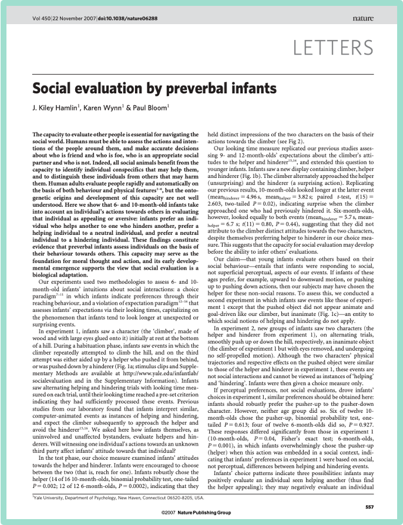

```{r}
#| message: false
library(tidyverse)
options(scipen = 999)

source("R/plot-normal.R")

green <- "#009E73"
yellow <- "#F0E442"
pink <- "#CC79A7"
crimson <- "#A51C30"

theme_set(theme_minimal(base_size = 22))

# The infant study (Hamlin, Wynn, and Bloom, 2007)
n_babies <- 16
n_helper <- 14
p_hat <- n_helper / n_babies

# 95% margin of error for a sample proportion. Students do not see this
# calculation today; it comes back when we learn the normal distribution
# for sample statistics.
margin_95 <- function(p, n, level = 0.95) {
  qnorm(1 - (1 - level) / 2) * sqrt(p * (1 - p) / n)
}
me_study <- margin_95(p_hat, n_babies)
```

# Do babies prefer helpers? {.inverse background-color="#A51C30"}

## The study

:::: columns
::: {.column width="62%"}
Researchers at the Yale Infant Cognition Center showed 10-month-old babies a short puppet show.

- A shape tries to climb a hill.
- Sometimes another shape __helps__ it up.
- Sometimes another shape __hinders__ it, pushing it back down.

Then each baby was offered the two shapes. Which one would the baby reach for?
:::

::: {.column width="38%"}
{fig-alt="First page of the paper Social evaluation by preverbal infants by J. Kiley Hamlin, Karen Wynn, and Paul Bloom, published in Nature, volume 450, in 2007." width="100%"}
:::
::::

<small>Hamlin, J. K., Wynn, K., & Bloom, P. (2007). [Social evaluation by preverbal infants](https://www.nature.com/articles/nature06288). *Nature*, 450, 557–559. Activity as seen in Chance, B. L., & Rossman, A. J. (2006). *Investigating Statistical Concepts, Applications, and Methods*. Videos: [Yale Infant Cognition Center](https://campuspress.yale.edu/infantlab/media/).</small>

## The helper



<small>Video description: a red circle with eyes tries to climb a hill. A second shape comes from below and pushes it up to the top.</small>

## The hinderer



<small>Video description: the red circle tries to climb the hill again. This time a different shape comes from above and pushes it back down.</small>

## Data collection



<small>Video description: a baby sits on a parent's lap. A researcher holds out the two shapes side by side, and the baby reaches for one of them.</small>

## The result

::: r-fit-text
__14 out of 16__ babies

chose the helper.
:::

## Why?

::: {.stat-callout .discussion}
**Discussion**

14 out of 16 babies chose the helper. What are some possible explanations for this?

Write down as many as you can with your neighbor.
:::

## Study design

The researchers designed the study to rule out many explanations. These were all balanced across babies:

- the __color__ of the shape
- the __shape__ itself
- __right__ vs. __left__ position
- ...

## Two explanations remain

1. 10-month-old babies are socially developed: they __prefer helpers__.
2. 10-month-old babies are making a __random choice__, and 14 out of 16 happened by chance.

. . .

::: {.stat-callout .discussion}
**Discussion**

Which of these two explanations is easier to model right now?
:::

## Hypotheses

Let $\pi$ be the proportion of __all__ 10-month-old babies who would choose the helper.

. . .

- __Null hypothesis__ $H_0$: babies are making a random choice. $\quad \pi = 0.5$
- __Alternative hypothesis__ $H_A$: babies are not making a random choice. $\quad \pi \neq 0.5$

. . .

The null hypothesis is the "nothing interesting is going on" model. It is the one we can model.

## Frequentist hypothesis testing

In __frequentist__ hypothesis testing, we

1. __start by assuming the null hypothesis is true__: babies are choosing randomly, $\pi = 0.5$,
2. ask how surprising our data would be in that world,
3. and if the data would be very surprising, reject the null hypothesis.

. . .

$\pi$ is a fixed (unknown) number. Probability describes what would happen over many repeated samples, like the long-run proportion of heads when we flip a coin many times.

## Today in conditional probability notation

Remember from last week:

$$P(\text{what we want the probability of} \mid \text{what we know or assume})$$

. . .

In frequentist hypothesis testing, what we __assume__ is the null hypothesis. So the probabilities we find today look like

$$P(\text{sample statistic} \mid \pi = 0.5)$$

. . .

We make judgments about __sample statistics__ if $\pi$ were 0.5. We do __not__ find probabilities of $\pi$.

# Welcome to Randomville {.inverse background-color="#A51C30"}

## If babies were choosing randomly

In Randomville, every baby picks the helper with probability 0.5, just like a fair coin flip.

::: {.stat-callout .discussion}
**Discussion**

Out of 16 Randomville babies, how many would you expect to choose the helper?
:::

## Would you be surprised?

If babies were making random choices, would you be surprised to see

- 7 babies choose the helper?

. . .

- 11 babies?

. . .

- 3 babies?

. . .

- 14 babies?

## Your surprise threshold

::: {.stat-callout .exercise}
**Exercise**

Write down the numbers that would surprise you if babies were choosing randomly. Below and above which number would you start getting surprised?
:::

```{r}
#| fig-height: 2.4
#| fig-width: 13
#| fig-align: center
#| fig-alt: "A number line from 0 to 16 babies who choose the helper. The middle value, 8, is circled; it corresponds to a proportion of 0.5. The ends of the line are labeled 0 and 1 as proportions."
tibble(k = 0:16) |>
  ggplot(aes(k, 0)) +
  geom_hline(yintercept = 0, linewidth = 1.2, color = "gray30") +
  geom_point(shape = 124, size = 9, color = "gray30") +
  annotate("point", x = 8, y = 0, shape = 21, size = 14, stroke = 1.5,
           color = pink, fill = NA) +
  geom_text(aes(label = k), vjust = 2.6, size = 7) +
  annotate("text", x = c(0, 8, 16), y = 0.9, label = c("0", "0.5", "1"),
           size = 6, color = "gray40") +
  annotate("text", x = -1.2, y = c(-0.55, 0.9), label = c("count", "proportion"),
           size = 6, hjust = 1, color = "gray40") +
  scale_y_continuous(limits = c(-1, 1.3)) +
  coord_cartesian(xlim = c(-4, 16.5), clip = "off") +
  theme_void()
```

## Researchers of Randomville

::: {.stat-callout .exercise}
**Exercise**

With your neighbor, flip a coin 16 times. Heads means the baby chose the helper. Write down the number of heads.

Each pair of you is a team of researchers observing 16 babies from Randomville.
:::

## The class's Randomville studies

Let's put all of our counts together.

<https://mdogucu.shinyapps.io/proportion/>

::: {.stat-callout .discussion}
**Discussion**

How many Randomville teams saw 14 or more babies choose the helper?
:::

```{r}
# 10,000 Randomville studies of 16 babies (not shown to students)
set.seed(9)
randomville <- tibble(study = 1:10000) |>
  mutate(n_helper = map_int(study, \(i) {
    choices <- sample(c("helper", "hinderer"), size = 16, replace = TRUE)
    sum(choices == "helper")
  }),
  p = n_helper / 16)
```

## 10,000 Randomville studies

Flipping coins takes time, so we asked R to run 10,000 Randomville studies of 16 babies each.

```{r}
#| fig-height: 5
#| fig-width: 13
#| fig-align: center
#| fig-alt: "Bar chart of the number of babies who chose the helper in 10,000 simulated Randomville studies of 16 babies. The distribution is symmetric and centered at 8, with most studies between 5 and 11. Bars at 14, 15, and 16 are so short they are barely visible."
null_counts <- randomville |> count(n_helper) |>
  complete(n_helper = 0:16, fill = list(n = 0))
ggplot(null_counts, aes(n_helper, n)) +
  geom_col(fill = green) +
  scale_x_continuous(breaks = 0:16) +
  labs(x = "Number of babies who chose the helper (out of 16)",
       y = "Number of studies")
```

## Null sampling distribution

The distribution of a sample statistic over many, many samples is called a __sampling distribution__.

. . .

The one we just made is the __null sampling distribution__: the sampling distribution of the sample statistic __if the null hypothesis were true__.

In notation: the distribution of $X \mid \pi = 0.5$, where $X$ is the number of babies (out of 16) who choose the helper.

. . .

It shows which results are typical, and which ones are surprising, in a world where babies choose randomly.

## Where does 14 fall?

```{r}
#| fig-height: 5
#| fig-width: 13
#| fig-align: center
#| fig-alt: "The same bar chart of 10,000 Randomville studies. The bars at 14 or more and at 2 or fewer are highlighted in pink with diagonal labels; all of the other bars are green. A dashed vertical line marks 14, the result of the real study. The pink bars are barely visible."
extreme <- function(k) k >= n_helper | k <= n_babies - n_helper
p_value <- mean(extreme(randomville$n_helper))
n_extreme <- sum(extreme(randomville$n_helper))

null_counts |>
  mutate(group = if_else(extreme(n_helper), "as extreme as 14", "less extreme")) |>
  ggplot(aes(n_helper, n, fill = group)) +
  geom_col() +
  geom_vline(xintercept = n_helper, linetype = "dashed", linewidth = 1) +
  annotate("label", x = n_helper, y = 1500, label = "real study: 14", size = 7) +
  scale_fill_manual(values = c("as extreme as 14" = pink, "less extreme" = green),
                    name = NULL) +
  scale_x_continuous(breaks = 0:16) +
  labs(x = "Number of babies who chose the helper (out of 16)",
       y = "Number of studies") +
  theme(legend.position = "top")
```

. . .

Only `r n_extreme` of the 10,000 Randomville studies were as extreme as 14 (14 or more, or 2 or fewer).

## p-value

The __p-value__ is the probability of observing a sample statistic as extreme as ours, or more extreme, __if the null hypothesis were true__.

. . .

In the 10,000 Randomville studies, `r n_extreme` were as extreme as 14, so the p-value is about $\frac{`r n_extreme`}{10{,}000} \approx `r p_value`$.

. . .

Why also $\le 2$? Our alternative hypothesis is $\pi \neq 0.5$: 2 out of 16 would be just as surprising as 14 out of 16, in the other direction.

## The p-value is a conditional probability

Remember from last week:

$$P(\text{what we want the probability of} \mid \text{what we know or assume})$$

. . .

Let $X$ be the number of babies (out of 16) who choose the helper. The p-value is

$$P(X \ge 14 \text{ or } X \le 2 \mid \pi = 0.5)$$

. . .

- We __assume__ $\pi = 0.5$: it goes after the $\mid$.
- We find the probability of the __sample statistic__: it goes before the $\mid$.

## What a p-value is not

The p-value is $P(\text{data this extreme} \mid \pi = 0.5)$.

It is __not__ $P(\pi = 0.5 \mid \text{data})$.

. . .

Remember: $P(A \mid B) \neq P(B \mid A)$!

. . .

In frequentist inference, $\pi$ is a fixed number, not a random variable. All of our probabilities are about sample statistics, assuming a value of $\pi$. So we __cannot__ make any probability statements about $\pi$ itself.

A p-value of 0.004 does __not__ mean there is a 0.4% chance that babies are choosing randomly.

## The null sampling distribution is approximately normal

```{r}
#| fig-height: 4.6
#| fig-width: 13
#| fig-align: center
#| fig-alt: "Histogram of the sample proportion p from 10,000 Randomville studies of 16 babies, on a scale from 0 to 1. It is symmetric and centered at 0.5. A smooth green normal curve with mean 0.5 and standard deviation 0.125 follows the histogram closely."
se_null <- sqrt(0.5 * 0.5 / n_babies)
ggplot(randomville, aes(p)) +
  geom_histogram(aes(y = after_stat(density)), binwidth = 1 / 16, boundary = 1 / 32,
                 fill = "gray80", color = "white") +
  stat_function(fun = dnorm, args = list(mean = 0.5, sd = se_null),
                color = green, linewidth = 1.6) +
  scale_x_continuous(limits = c(-0.05, 1.05), breaks = seq(0, 1, 0.125)) +
  labs(x = "p: proportion of babies who chose the helper", y = NULL) +
  theme(axis.text.y = element_blank(), panel.grid.minor = element_blank())
```

Using the proportion $p$ instead of the count, the null sampling distribution is approximately normal with mean 0.5 and standard deviation `r se_null`.

## Standard error

The standard deviation of a sampling distribution has its own name: the __standard error__.

. . .

For the infant study, if the null hypothesis were true,

$$p \mid \pi = 0.5 \ \sim \ N(0.5, 0.125^2)$$

approximately: mean 0.5, standard error 0.125.

. . .

::: {.stat-callout .note-tip}
**Note**

You will not need to calculate standard errors in this course. When you need the null sampling distribution, we will give you its mean and standard error.
:::

## p-value with `plot_normal()`

Now we can find $P(p \ge 0.875 \mid \pi = 0.5)$ with the function from last week:

```{r}
#| echo: true
#| fig-height: 3.4
#| fig-width: 10
#| fig-align: center
#| fig-alt: "Normal curve for p with mean 0.5 and standard deviation 0.125. The area to the right of 0.875 is shaded pink and is tiny; the label reads Area = 0.0013."
plot_normal("p", mean = 0.5, sd = 0.125, lower = 0.875)
```

. . .

Two tails: $P(p \ge 0.875 \text{ or } p \le 0.125 \mid \pi = 0.5) \approx 2 \times 0.0013 \approx 0.003$, close to the `r p_value` from the 10,000 Randomville studies.

## Significance level

How small is small enough to be "surprised"?

. . .

- We decide on a __surprise threshold__ before looking at the data: the __significance level__, $\alpha$.
- Most often $\alpha = 0.05$. What the threshold should be is a debated topic!

. . .

If the p-value $< \alpha$: we __reject__ $H_0$. The result is __statistically significant__.

If the p-value $\ge \alpha$: we __fail to reject__ $H_0$.

## Conclusion

The p-value, about `r round(p_value, 3)`, is less than $\alpha = 0.05$.

If babies were choosing randomly, it would be very unlikely to see 14 or more (or 2 or fewer) out of 16 babies choose the helper. So we __reject__ the random choice model in favor of the alternative.

. . .

::: {.stat-callout .discussion}
**Discussion**

- Do you agree with the authors' claim: "These findings constitute evidence that preverbal infants assess individuals on the basis of their behaviour towards others"? Why? Why not?
- Do the findings generalize to all infants?
:::

## Scope of the conclusions

- The study design balanced the color, the shape, and the side of the toys, so these do not explain the result.
- The evidence supports the authors' claim __for babies like the ones in the study__.

. . .

- The 16 babies were __not a random sample__ of all infants: their families volunteered to take part, near Yale. Generalizing to all infants is a stretch.
- 16 babies is a small sample.

## Could we have made an error?

We rejected the random choice model. Suppose for a moment that it was actually true. Could 14 out of 16 babies have chosen the helper anyway?

. . .

Yes! Low probability, but still possible. `r n_extreme` of our 10,000 Randomville studies did.

. . .

If the null hypothesis is true and we reject it, we made a __Type I error__. Its probability is $\alpha$: when $\alpha = 0.05$, we accept making this error 5% of the time when $H_0$ is true.

$$\alpha = P(\text{reject } H_0 \mid H_0 \text{ is true})$$

## Two types of errors

| Decision | $H_0$ is true | $H_0$ is false |
|---|---|---|
| Reject $H_0$ | Type I error | Correct decision |
| Fail to reject $H_0$ | Correct decision | Type II error |

: Possible outcomes of a hypothesis test

. . .

::: {.stat-callout .exercise}
**Exercise**

In the context of the infant study, what would a Type I error be? What would a Type II error be? Which one could we have made?
:::

## Errors as conditional probabilities

| Error | Conditional probability |
|---|---|
| Type I error | $P(\text{reject } H_0 \mid H_0 \text{ is true}) = \alpha$ |
| Type II error | $P(\text{fail to reject } H_0 \mid H_0 \text{ is false})$ |

: Type I and Type II errors in conditional probability notation

. . .

Each one is a probability about our __decision__ (which comes from the sample), given what is true about the population.

## Errors in the infant study - answer

- __Type I error:__ concluding that babies are not choosing randomly, when they actually are.
- __Type II error:__ concluding that we do not have evidence against random choice, when babies actually do prefer one of the shapes.

. . .

We rejected $H_0$, so the only error we could have made is a __Type I error__.

## Example: a trial

In a courtroom, the defendant is innocent until proven guilty.

- $H_0$: the defendant is innocent.
- $H_A$: the defendant is guilty.

::: {.stat-callout .discussion}
**Discussion**

What would a Type I error be? What would a Type II error be?
:::

## Example: a trial - answer

| Decision | Defendant is innocent ($H_0$ true) | Defendant is guilty ($H_0$ false) |
|---|---|---|
| Convict (reject $H_0$) | Type I error: an innocent person goes to jail | Correct decision |
| Acquit (fail to reject $H_0$) | Correct decision | Type II error: a guilty person goes free |

: Possible outcomes of a trial

. . .

"Beyond reasonable doubt" plays the role of $\alpha$: the jury convicts only if the evidence would be very surprising for an innocent person. We want $P(\text{convict} \mid \text{innocent})$ to be small.

## Example: a new drug

A drug company tests whether a new migraine drug relieves headaches better than a placebo.

- $H_0$: the drug works no better than the placebo.
- $H_A$: the drug works better than the placebo.

::: {.stat-callout .discussion}
**Discussion**

- What would a Type I error be? Who is hurt by it?
- What would a Type II error be? Who is hurt by it?
:::

## Example: a new drug - answer

- __Type I error:__ concluding that the drug works when it does not. Patients pay for, and take, a drug that does not help them, maybe with side effects.
- __Type II error:__ concluding that we do not have evidence that the drug works when it does. A helpful drug never reaches patients.

. . .

Which error is worse depends on the context. A smaller $\alpha$ makes Type I errors less likely, but Type II errors more likely.

## Your turn {.smaller}

::: {.stat-callout .exercise}
**Exercise**

Suppose a new team of researchers repeats the study with 64 babies, and 40 of them choose the helper ($p = 0.625$).

If babies were choosing randomly, the null sampling distribution of $p$ would be approximately normal with mean 0.5 and standard error 0.0625.

a. State the hypotheses.
b. Use `plot_normal()` to find the p-value. Remember to count both tails.
c. What is your conclusion at $\alpha = 0.05$?
d. Which type of error could you have made?
:::

## Your turn - answers {.smaller}

```{r}
#| echo: true
#| fig-height: 3
#| fig-width: 10
#| fig-align: center
#| fig-alt: "Normal curve for p with mean 0.5 and standard deviation 0.0625. The area to the right of 0.625 is shaded pink, and the label reads Area = 0.0228."
plot_normal("p", mean = 0.5, sd = 0.0625, lower = 0.625)
```

a. $H_0: \pi = 0.5$ (random choice) and $H_A: \pi \neq 0.5$.
b. p-value $= 2 \times 0.0228 \approx 0.046$. 0.625 is 2 standard errors above 0.5.
c. $0.046 < 0.05$, so we reject $H_0$, but just barely!
d. A Type I error: babies may actually be choosing randomly.

# Confidence intervals {.inverse background-color="#A51C30"}

## If not 0.5, then what?

We rejected $\pi = 0.5$. So what __is__ $\pi$, the proportion of all 10-month-old babies who would choose the helper?

. . .

Our best single guess, the __point estimate__, is the sample proportion:

$$p = \frac{14}{16} = `r p_hat`$$

. . .

::: {.stat-callout .discussion}
**Discussion**

If the researchers repeated the study with 16 different babies, would they get 0.875 again?
:::

## Estimate ± margin of error

A different sample would give a different estimate. So instead of a single number, we give a range of plausible values:

$$\text{estimate} \pm \text{margin of error}$$

. . .

For the infant study, a 95% confidence interval is

$$`r p_hat` \pm `r round(me_study, 2)`$$

that is, from about `r round(p_hat - me_study, 2)` to 1.

. . .

The margin of error is based on the standard error. You will not need to calculate it: today we focus on what an interval means.

## The infant study interval

```{r}
#| fig-height: 3.2
#| fig-width: 13
#| fig-align: center
#| fig-alt: "A number line for pi from 0 to 1. A horizontal segment goes from 0.71 to 1, with a point at the estimate 0.875. A dashed vertical line at 0.5 marks the random choice model; it is outside the interval."
tibble(est = p_hat, lo = p_hat - me_study, hi = min(p_hat + me_study, 1)) |>
  ggplot(aes(y = 0)) +
  geom_vline(xintercept = 0.5, linetype = "dashed", linewidth = 1) +
  annotate("label", x = 0.5, y = 0.6, label = "random choice: 0.5", size = 7) +
  geom_segment(aes(x = lo, xend = hi, yend = 0), linewidth = 3, color = green) +
  geom_point(aes(x = est), size = 7, color = "black") +
  annotate("text", x = p_hat, y = -0.5, label = "estimate: 0.875", size = 7) +
  scale_x_continuous(limits = c(0, 1), breaks = seq(0, 1, 0.1)) +
  scale_y_continuous(limits = c(-0.8, 0.9)) +
  labs(x = expression(pi), y = NULL) +
  theme(axis.text.y = element_blank(), panel.grid.major.y = element_blank(),
        panel.grid.minor = element_blank())
```

::: {.stat-callout .discussion}
**Discussion**

Is 0.5 a plausible value for $\pi$ according to this interval? How does this compare with our hypothesis test?
:::

## Your Randomville interval

::: {.stat-callout .exercise}
**Exercise**

Find your team's number of heads in the table on the next slide. Write your 95% confidence interval as estimate ± margin of error, and as an interval from lower to upper.

In Randomville, we *know* that $\pi = 0.5$. Did your interval capture 0.5?
:::

## Margin of error for 16 babies {.smaller}

```{r}
me_table <- tibble(heads = 0:16) |>
  mutate(estimate = heads / 16,
         margin = margin_95(estimate, 16)) |>
  mutate(heads = as.character(heads),
         estimate = sprintf("%.3f", estimate),
         margin = sprintf("%.2f", margin))
# Two halves side by side so the table fits on the slide
knitr::kable(
  bind_cols(me_table[1:9, ], rbind(me_table[10:17, ], c("", "", ""))),
  col.names = rep(c("Heads", "Estimate", "Margin of error"), 2),
  caption = "95% margin of error for 16 babies, by number of heads (helper)",
  align = "cccccc"
)
```

For example, 10 heads: $0.625 \pm 0.24$, from 0.385 to 0.865. This interval captures 0.5.

```{r}
# 100 Randomville samples of 16 babies, plus the real infant study on top
set.seed(103)
intervals <- tibble(sample = 1:100) |>
  mutate(heads = map_int(sample, \(i) sum(sample(0:1, 16, replace = TRUE))),
         source = "Randomville") |>
  bind_rows(tibble(sample = 103, heads = n_helper, source = "Infant study")) |>
  mutate(estimate = heads / 16,
         margin = margin_95(estimate, 16),
         lower = pmax(estimate - margin, 0),
         upper = pmin(estimate + margin, 1),
         captured = lower <= 0.5 & upper >= 0.5,
         group = case_when(source == "Infant study" ~ "Infant study",
                           captured ~ "captures 0.5",
                           TRUE ~ "misses 0.5"))
n_capture <- sum(intervals$captured[intervals$source == "Randomville"])
```

```{r}
# Same plot for both slides; the second one adds the infant study on top
plot_intervals <- function(data) {
  ggplot(data, aes(y = sample, color = group, shape = group)) +
    geom_vline(xintercept = 0.5, linetype = "dashed") +
    geom_segment(aes(x = lower, xend = upper, yend = sample, linewidth = group)) +
    geom_point(aes(x = estimate), size = 2.2) +
    scale_linewidth_manual(values = c("captures 0.5" = 0.5, "misses 0.5" = 1.4,
                                      "Infant study" = 1.6), name = NULL) +
    scale_color_manual(values = c("captures 0.5" = green, "misses 0.5" = pink,
                                  "Infant study" = "black"), name = NULL) +
    scale_shape_manual(values = c("captures 0.5" = 16, "misses 0.5" = 17,
                                  "Infant study" = 15), name = NULL) +
    scale_x_continuous(limits = c(0, 1), breaks = seq(0, 1, 0.1)) +
    scale_y_continuous(limits = c(0, 104)) +
    labs(x = expression(pi), y = "Sample") +
    theme(legend.position = "top", panel.grid.minor = element_blank(),
          axis.text.y = element_blank())
}
```

## 100 Randomville intervals

```{r}
#| fig-height: 6.3
#| fig-width: 13
#| fig-align: center
#| fig-alt: !expr glue::glue("One hundred 95 percent confidence intervals from Randomville studies of 16 babies, where pi is 0.5, drawn as horizontal segments stacked from bottom to top on an axis for pi from 0 to 1. A dashed vertical line marks 0.5. {n_capture} of the intervals cross the dashed line and are green, and {100 - n_capture} miss it and are pink with triangles.")
plot_intervals(filter(intervals, source == "Randomville"))
```

## 100 Randomville intervals

Each interval comes from a Randomville sample of 16 babies, where we know that $\pi = 0.5$.

. . .

`r n_capture` of the 100 Randomville intervals captured $\pi = 0.5$.

. . .

In notation: $P(\text{interval captures } \pi \mid \pi = 0.5) \approx \frac{`r n_capture`}{100}$. The interval is the random part; $\pi$ is fixed.

## Adding the infant study

```{r}
#| fig-height: 6.3
#| fig-width: 13
#| fig-align: center
#| fig-alt: !expr glue::glue("The same 100 Randomville confidence intervals, {n_capture} green ones that cross the dashed line at 0.5 and {100 - n_capture} pink ones that miss it. Above them, after a small gap, a thick black interval shows the real infant study, from 0.71 to 1, with its estimate at 0.875. It does not cross 0.5.")
plot_intervals(intervals)
```

## Adding the infant study

The black interval at the top is the real infant study: from about `r round(p_hat - me_study, 2)` to 1.

. . .

The infant study interval does not look like a Randomville interval. This is the same evidence the hypothesis test gave us, seen in a different way.

::: notes
With only 16 babies, this margin of error method captures the true value about 92% of the time in the long run, a little below 95%. It gets closer to 95% with larger samples. The infant study's upper end, 0.875 + 0.16 = 1.04, is cut at 1 because a proportion cannot be larger than 1.
:::

## What does 95% confidence mean?

The __confidence level__, 95%, is about the __method__, not one interval:

if we took many samples and built an interval from each one, about 95% of the intervals would capture the true value of the parameter.

. . .

A single interval either captures $\pi$ or it does not. We do not know which!

. . .

::: {.stat-callout .example}
**Interpretation**

We are 95% confident that between about `r round(p_hat - me_study, 2)` and 1 of all 10-month-old babies (like the ones in the study) would choose the helper.
:::

## Confident, not 95% probability

Just like the p-value, the 95% is a probability about __samples__, not about $\pi$:

$$P(\text{the interval from a new sample captures } \pi \mid \pi) = 0.95$$

. . .

- __Before__ we take a sample, the interval is random: 95% of samples give an interval that captures $\pi$.
- __After__ we take the sample, the interval (`r round(p_hat - me_study, 2)`, 1) is fixed, and $\pi$ is fixed. $\pi$ is either in it or not.

. . .

So we __cannot__ say "there is a 95% probability that $\pi$ is between `r round(p_hat - me_study, 2)` and 1." That would be a probability about $\pi$.

## Correct or not?

::: {.stat-callout .exercise}
**Exercise**

For the infant study, which statements are correct?

a. There is a 95% probability that $\pi$ is between `r round(p_hat - me_study, 2)` and 1.
b. We are 95% confident that $\pi$ is between `r round(p_hat - me_study, 2)` and 1.
c. If we repeated the study many times, about 95% of the intervals would capture $\pi$.
d. There is a 0.4% probability that babies are choosing randomly.
e. If babies were choosing randomly, there would be a 0.4% probability of seeing results as extreme as ours.
:::

## Correct or not? - answers

a. __Not correct:__ a probability about $\pi$.
b. __Correct.__
c. __Correct:__ this is what "95% confidence" means.
d. __Not correct:__ a probability about $\pi$. The p-value is not $P(\pi = 0.5 \mid \text{data})$.
e. __Correct:__ this is the p-value, $P(\text{data this extreme} \mid \pi = 0.5)$.

## Wider or narrower?

```{r}
#| fig-height: 3.6
#| fig-width: 13
#| fig-align: center
#| fig-alt: "Three confidence intervals for pi, each centered at 0.875. Top: 95 percent confidence with 16 babies, 0.875 plus or minus 0.16. Middle: 99 percent confidence with 16 babies, 0.875 plus or minus 0.21, wider. Bottom: 95 percent confidence with 160 babies, 0.875 plus or minus 0.05, much narrower."
compare <- tibble(
  label = c("95% confidence, 16 babies", "99% confidence, 16 babies",
            "95% confidence, 160 babies"),
  n = c(16, 16, 160), level = c(0.95, 0.99, 0.95)) |>
  mutate(margin = margin_95(p_hat, n, level),
         lower = p_hat - margin, upper = pmin(p_hat + margin, 1),
         text = paste0(p_hat, " %+-% ", round(margin, 2)),
         label = factor(label, levels = rev(label)))
ggplot(compare, aes(y = label)) +
  geom_segment(aes(x = lower, xend = upper, yend = label), linewidth = 3, color = green) +
  geom_point(aes(x = p_hat), size = 5) +
  geom_text(aes(x = 0.6, label = text), size = 7, hjust = 1, parse = TRUE) +
  scale_x_continuous(limits = c(0.4, 1), breaks = seq(0.4, 1, 0.1)) +
  labs(x = expression(pi), y = NULL) +
  theme(panel.grid.minor = element_blank())
```

::: {.stat-callout .discussion}
**Discussion**

What makes an interval wider? What makes it narrower?
:::

## Wider or narrower? - answer

- __Higher confidence__ (99% instead of 95%) → __wider__ interval. To be more confident that we capture $\pi$, we need a wider net.
- __Larger sample__ (160 babies instead of 16) → __narrower__ interval. More data, more precise estimate.

## Summary: hypothesis testing {.smaller}

- __Frequentist hypothesis test:__ start by assuming the null hypothesis $H_0$ (random choice, $\pi = 0.5$) is true, and see what data would look like: the __null sampling distribution__.
- The standard deviation of a sampling distribution is the __standard error__. With its mean and standard error, we can find a p-value with `plot_normal()`.
- __p-value:__ the probability of a sample statistic as extreme as ours, or more extreme, if $H_0$ were true. If the p-value $< \alpha$, reject $H_0$.
- __Type I error:__ rejecting a true $H_0$ (probability $\alpha$). __Type II error:__ failing to reject a false $H_0$.
- The p-value is $P(\text{data this extreme} \mid \pi = 0.5)$, not $P(\pi = 0.5 \mid \text{data})$.

## Summary: confidence intervals {.smaller}

- __Confidence interval:__ estimate ± margin of error, a range of plausible values for the parameter.
- __Confidence level:__ the proportion of intervals that would capture the true parameter if we repeated the sampling many times.
- The p-value and the confidence level are probabilities about __sample statistics__, assuming a value of $\pi$. In frequentist inference we cannot make probability statements about $\pi$: no "95% probability that $\pi$ is in the interval."
- A 95% confidence interval that does not include 0.5 usually goes together with rejecting $H_0: \pi = 0.5$ at $\alpha = 0.05$.
