<!--
30-minute version of week08/8b-machine-learning.qmd (stats6-slides-main).
Handout: 10b-extra-statistical-learning-handout.pdf (2 pages).
Image slides and alt text are copied unchanged from the original; only the
image paths changed (images/lec10b-*.png, resized copies).

Timing (about 30 min):
  Models and classification   3 min
  Steps 0-3 draw + pixelate   5 min
  Step 4 write algorithm      6 min
  Step 5 test, 10 images      8 min
  Evaluate + discuss          4 min
  Training vs testing         2 min
  Key takeaways               2 min
-->

## Models

A model is a simplified representation of the real world.

::: {.nonincremental}

- Keeps the **important features**, leaves out **unnecessary details**
- Example: a map keeps roads and landmarks, leaves out every tree

:::

A **statistical model** uses data to map

👉 inputs (explanatory variables) → output (response: a class or a prediction)

and it includes uncertainty.

## Classification Model

A model that sorts items into predefined categories, or **classes**.

::: {.nonincremental}

- Email: **spam or not spam**
- X-rays: **disease or no disease**
- Credit cards: **fraud or no fraud**
- Images: **cat, dog, or bird**

:::

By turning **images into data**, a computer can find patterns in images.

## Step 0: Get into teams of 4 - 5

Grab a handout: **Statistical Learning**.

## Step 1: Create a landscape drawing area, 16 squares by 9 squares

::: {style="text-align: center;"}

```{r}
#| fig-align: center
#| echo: false
#| out-width: 60%
#| fig-alt: "A blank rectangular grid with a blue border and a white background overlaid with a uniform light blue grid of evenly spaced rows and columns, containing no data, labels, or axes, suggesting an empty chart or graph template awaiting content."
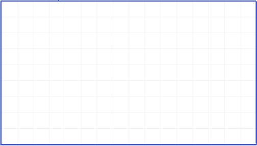
```

:::

## Step 2: Draw _______ within your drawing area in less than 15 seconds without showing it to your teammates.

. . .


## Step 2: Draw a book within your drawing area in less than 15 seconds without showing it to your neighbors.

```{r}
#| echo: false
countdown::countdown(minutes = 0, seconds = 15)
```


## Step 2.5: Now you can take a look at each others' drawings.

. . .

An example: 

```{r}
#| fig-align: center
#| echo: false
#| out-width: 60%
#| fig-alt: "A hand-drawn pencil sketch on graph paper, enclosed in a rectangular border, showing a simple open book icon drawn in pencil — two symmetrical curved pages spread open at a central spine, with diagonal lines on each page representing text"
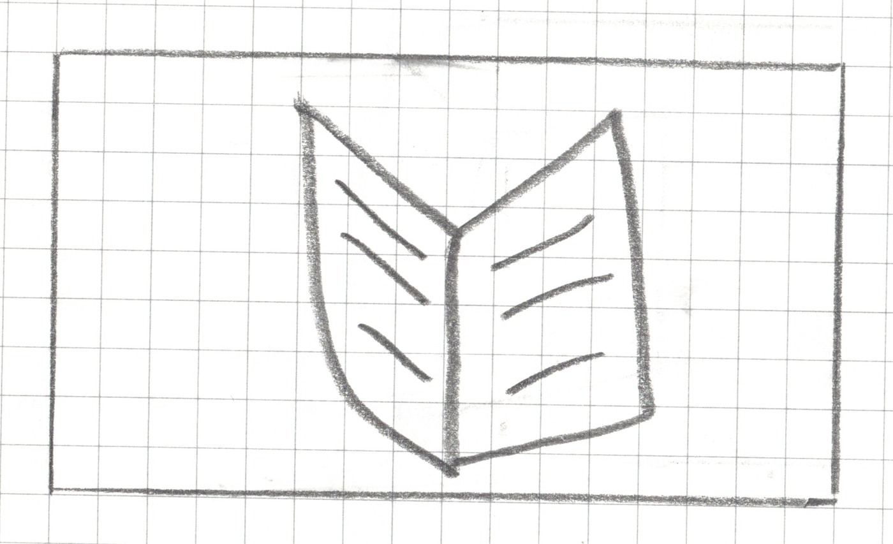
```

## Step 3: Pixelate your drawing

For any square that has a line, a dot or any pen/pencil mark, shade the whole square.

::: {style="text-align: center;"}

```{r}
#| fig-align: center
#| out-width: 60%
#| echo: false
#| fig-alt: A pixel art design drawn in pencil on a 16x9 graph paper grid. Columns and rows are not labeled but for the purposes of this alt text assume that the columns are labeled a-p, rows 1-9. The irregular shape consists of various shades of gray pencil markings, with some internal white (unshaded) cells. Shaded cells include f2, g2, k2, l2, f3, g3, h3, j3, l3, f4, g4, h4, i4, j4, k4, l4, f5, g5, h5, i5, j5, k5, l5, f6, g6, h6, i6, j6, l6, f7, g7, h7, i7, j7, k7, l7, g8, h8, j8, k8, l8, m8, h9, i9.
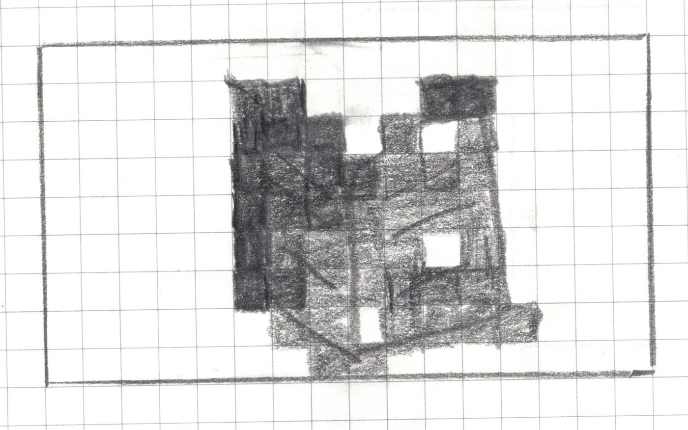
```

:::

## Step 4: Write your algorithm

Use your drawing and your teammates' drawings (only your teammates') to write an algorithm (a set of rules) that decides whether a drawn book is **open** or **closed**.

Use the **Step 3** box on your handout.

```{r}
#| echo: false
countdown::countdown(minutes = 5, seconds = 0)
```

## An Example: The Vertical Gap Scanner

1. Go through the image one row at a time, from top to bottom.
2. A row is a **gapped row** if it has at least one filled square **and** 3 empty squares between its leftmost and rightmost filled squares.
3. Count the gapped rows: `gap_row_count`.
4. `if` `gap_row_count` >= 1 `then` predict "open", `else` predict "closed".

## Step 5: Test your model

These 10 drawings are your **testing data**. Your team has not seen them.

For each one, apply your rules **exactly as written** and circle your prediction on the handout. Then circle the actual class.

## Image 1

::: {style="text-align: center;"}

```{r}
#| fig-align: center
#| out-width: 60%
#| echo: false
#| fig-alt: closed book image with only edges and spine drawn from the back cover view
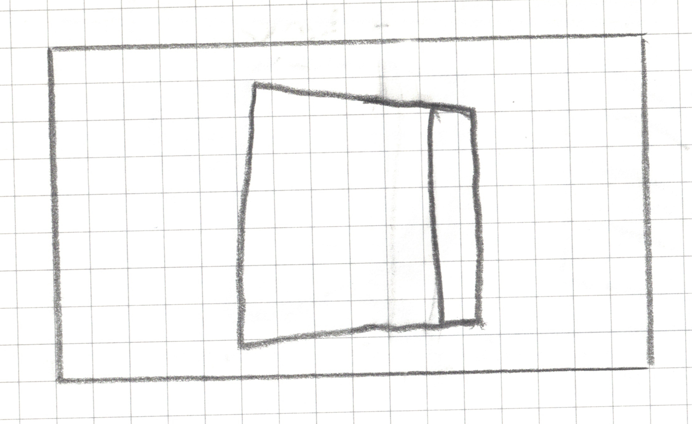
```

:::

`actual_class` = closed


## Image 1

::: {style="text-align: center;"}

```{r}
#| fig-align: center
#| out-width: 60%
#| echo: false
#| fig-alt: A pixel art design drawn in pencil on a 16x9 graph paper grid. Columns and rows are not labeled but for the purposes of this alt text assume that the columns are labeled a-p, rows 1-9. The irregular shape consists of various shades of gray pencil markings, with some internal white (unshaded) cells. Shaded cells include f2, g2, h2, i2, j2, k2, f3, k3, l3, f4, k4, l4, f5, k5, l5, f6, k6, l6, f7, k7, l7, f8, g8, h8, i8, j8, k8, l8
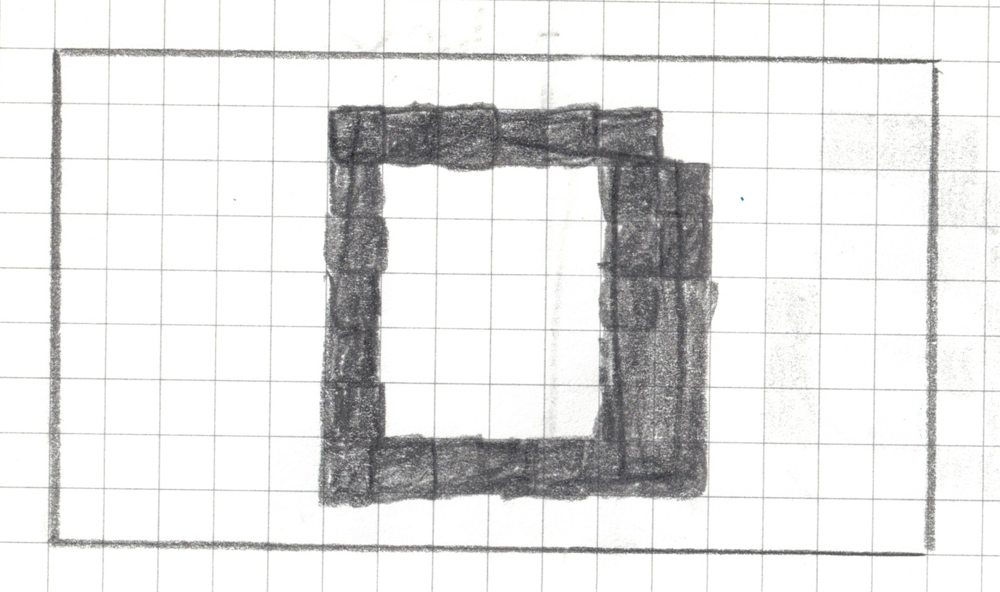
```

:::

`predicted_class` = ?


## Image 2

::: {style="text-align: center;"}

```{r}
#| fig-align: center
#| out-width: 60%
#| fig-alt: An open book illustration with only edges drawn. We can see back cover spine and front cover.
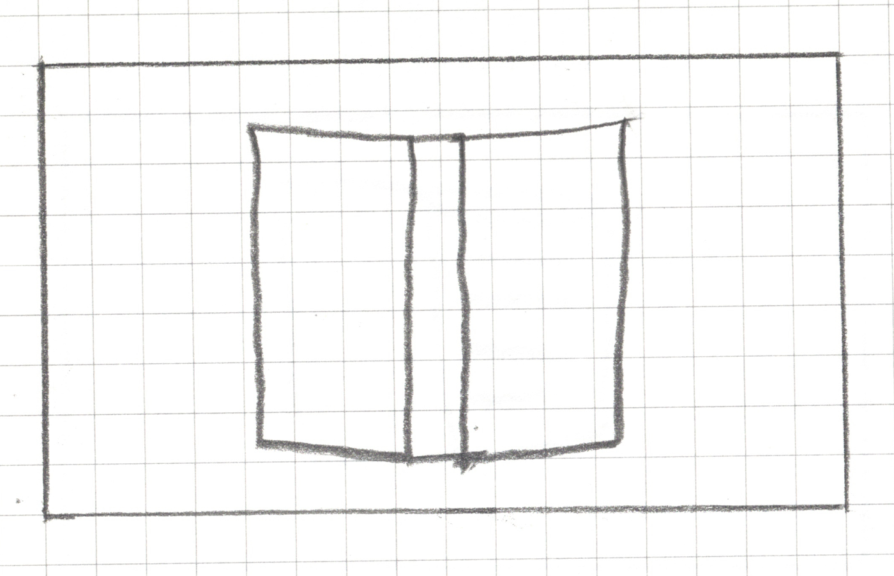
```

:::

`actual_class` = open


## Image 2

::: {style="text-align: center;"}

```{r}
#| fig-align: center
#| out-width: 60%
#| echo: false
#| fig-alt: A pixel art design drawn in pencil on a 16x9 graph paper grid. Columns and rows are not labeled but for the purposes of this alt text assume that the columns are labeled a-p, rows 1-9. The irregular shape consists of various shades of gray pencil markings, with some internal white (unshaded) cells. Shaded cells include e2, f2, g2, h2, i2, j2, k2, l2, e3, h3, i3, l3, e4, h4, i4, l4, e5, h5, i5, l5, e6, h6, i6, l6, e7, h7, i7, l7, e8, f8, g8, h8, i8, j8, k8, l8.
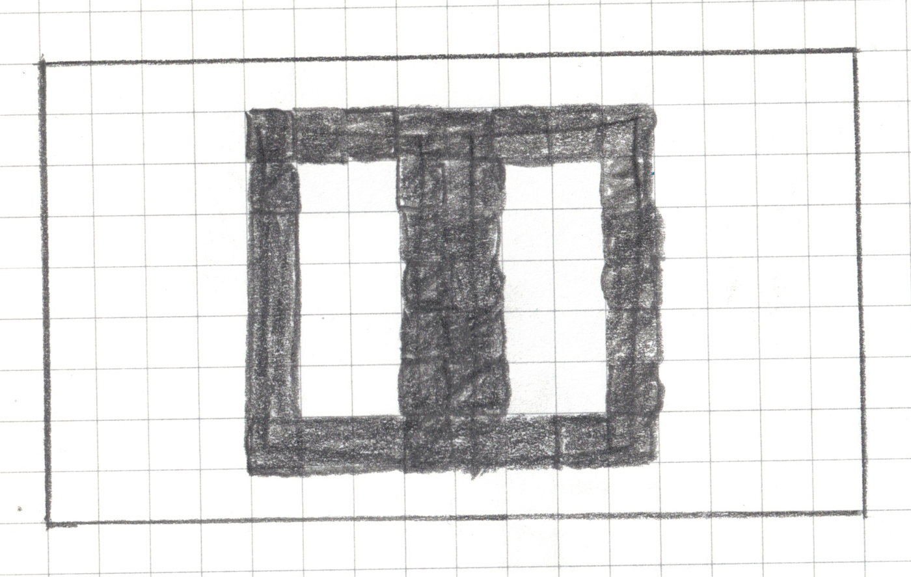
```

:::

`predicted_class` = ?


## Image 3

::: {style="text-align: center;"}

```{r}
#| fig-align: center
#| out-width: 60%
#| fig-alt: an open book viewed from a slight overhead angle, giving it a three-dimensional, tent-like appearance where the spine points upward.
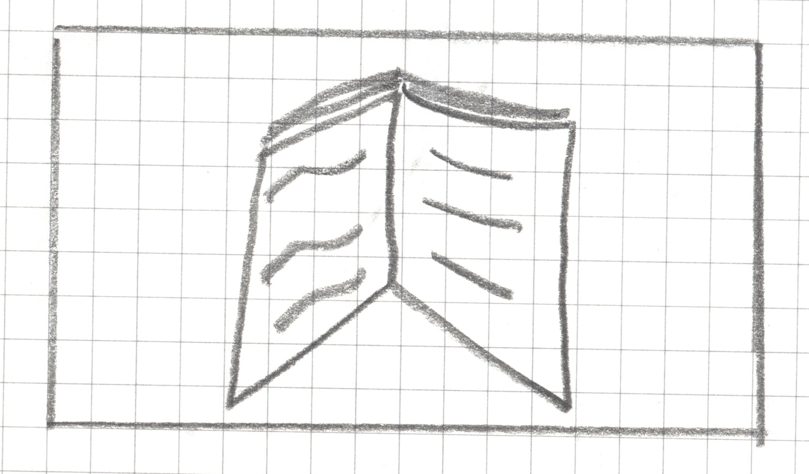
```

:::

`actual_class` = open


## Image 3

::: {style="text-align: center;"}

```{r}
#| fig-align: center
#| out-width: 60%
#| fig-alt: A pixel art design drawn in pencil on a 16x9 graph paper grid. Columns and rows are not labeled but for the purposes of this alt text assume that the columns are labeled a-p, rows 1-9. The irregular shape consists of various shades of gray pencil markings, with some internal white (unshaded) cells. Shaded cells include h1, f2, g2, h2, i2, j2, k2, l2, f3, g3, h3, i3, j3, l3, e4, f4, h4, i4, k4, l4, e5, f5, g5, h5, i5, j5, k5, l5, e6, f6, g6, h6, j6, k6, l6, e7, f7, g7, h7, i7, j7, l7, e8, f8, k8, l8, e9, l9
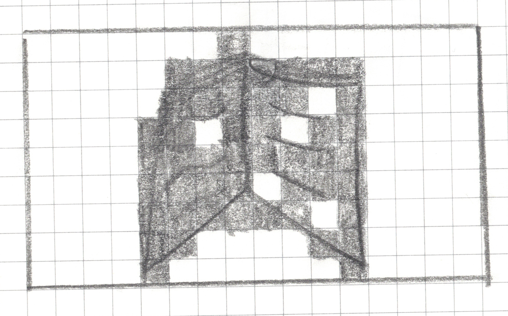
```

:::

`predicted_class` = ?


## Image 4

::: {style="text-align: center;"}

```{r}
#| fig-align: center
#| out-width: 60%
#| fig-alt: The drawing depicts an open book or notebook viewed from a straight-on perspective. The book is split into two pages by a central vertical line representing the spine. The left page is completely blank. The right page features five thick, straight, horizontal pencil strokes stacked vertically to represent lines of written text.
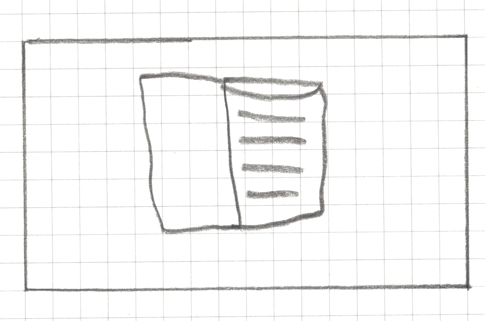
```

:::

`actual_class` = open


## Image 4

::: {style="text-align: center;"}

```{r}
#| fig-align: center
#| out-width: 60%
#| fig-alt: A pixel art design drawn in pencil on a 16x9 graph paper grid. Columns and rows are not labeled but for the purposes of this alt text assume that the columns are labeled a-p, rows 1-9. The irregular shape consists of various shades of gray pencil markings, with some internal white (unshaded) cells. Shaded cells include e2, f2, g2, h2, i2, j2, k2, e3, h3, i3, j3, k3, e4, h4, i4, j4, k4, e5, h5, i5, j5, k5, e6, h6, i6, j6, k6, e7, f7, g7, h7, i7, j7, k7
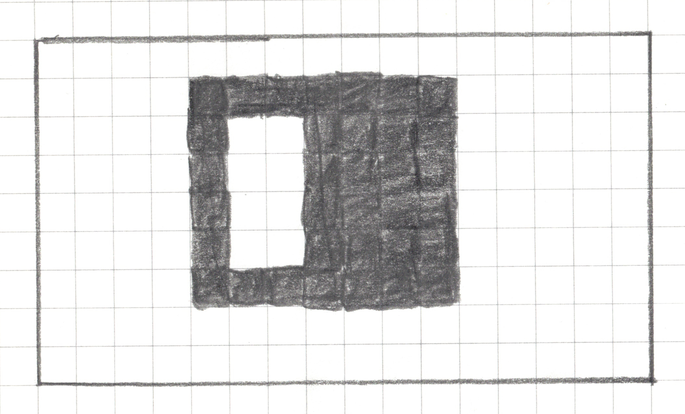
```

:::

`predicted_class` = ?


## Image 5

::: {style="text-align: center;"}

```{r}
#| fig-align: center
#| out-width: 60%
#| fig-alt: The drawing depicts a single closed book standing upright and viewed from a dynamic three-quarter side angle.
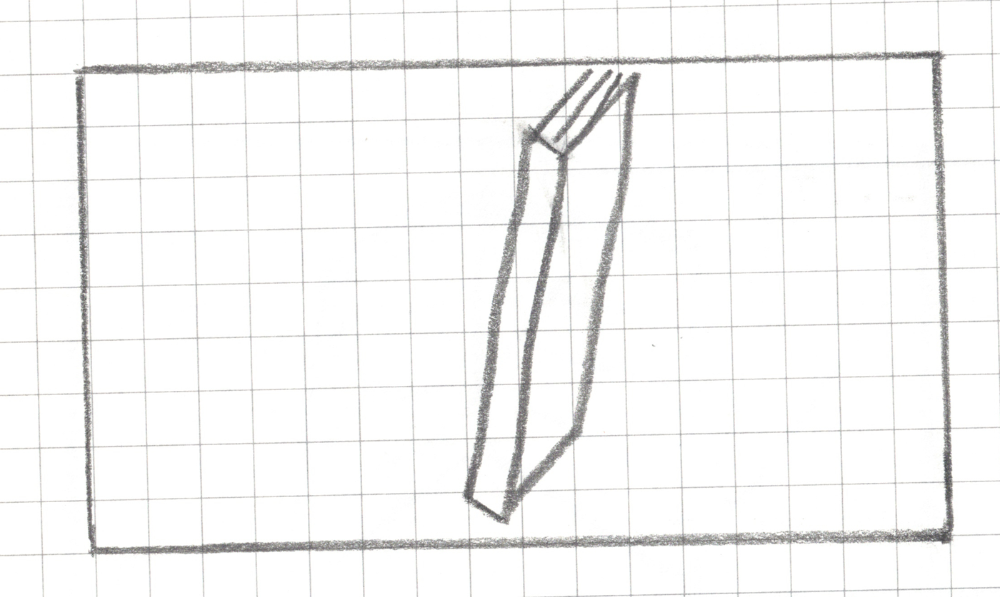
```

:::

`actual_class` = closed


## Image 5

::: {style="text-align: center;"}

```{r}
#| fig-align: center
#| out-width: 60%
#| fig-alt: A pixel art design drawn in pencil on a 16x9 graph paper grid. Columns and rows are not labeled but for the purposes of this alt text assume that the columns are labeled a-p, rows 1-9. The irregular shape consists of various shades of gray pencil markings, with some internal white (unshaded) cells. Shaded cells include i1, j1, k1, i2, j2, i3, j3, h4, i4, j4, h5, i5, j5, h5, i6, j6, h7, i7, j7, h8, i8, h9
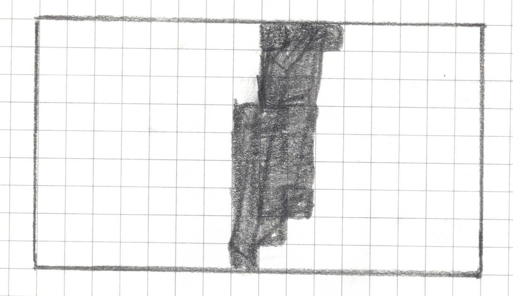
```

:::

`predicted_class` = ?


## Image 6

::: {style="text-align: center;"}

```{r}
#| fig-align: center
#| out-width: 60%
#| fig-alt: A view looking directly at the exposed page edges of a thick, closed book. The shape is bounded by a U-shaped bottom curve representing the book's cover, while the top edge dips downward in a smooth, concave crescent curve to suggest the natural indentation of the pages near the spine.
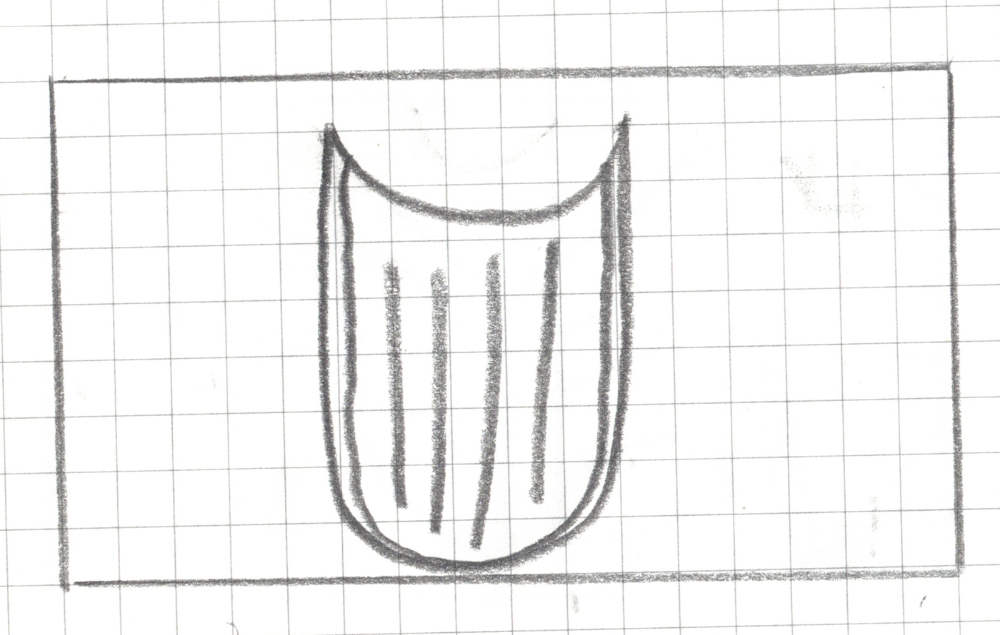
```

:::

`actual_class` = closed


## Image 6

::: {style="text-align: center;"}

```{r}
#| fig-align: center
#| out-width: 60%
#| fig-alt: A pixel art design drawn in pencil on a 16x9 graph paper grid. Columns and rows are not labeled but for the purposes of this alt text assume that the columns are labeled a-p, rows 1-9. The irregular shape consists of various shades of gray pencil markings, with some internal white (unshaded) cells. Shaded cells include f2, j2, f3, g3, h3, i3, j3, f4, g4, h4, i4, j4, f5, g5, h5, i5, j5, f6, g6, h6, i6, j6, f7, g7, h7, i7, j7, f8, g8, h8, i8, j8, f9, g9, h9, i9, j9
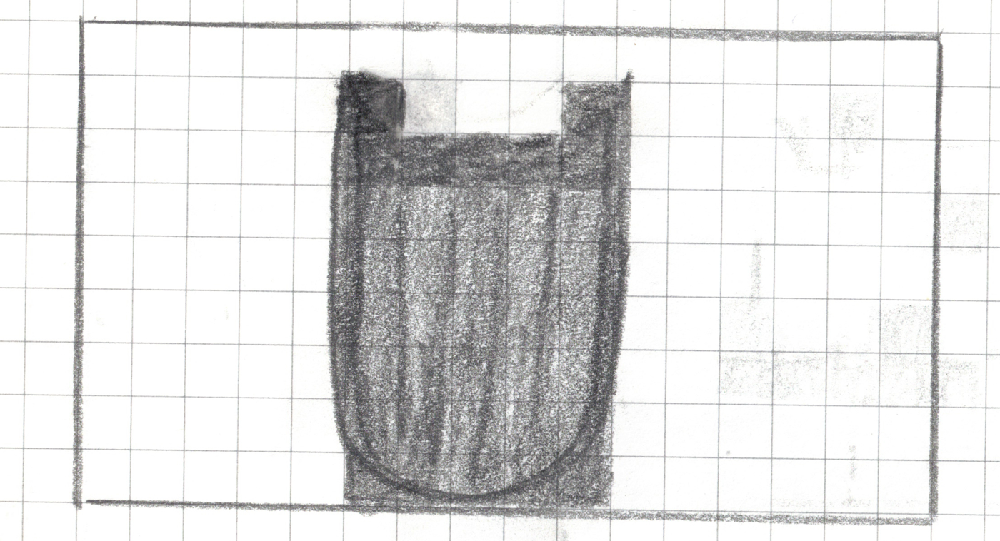
```

:::

`predicted_class` = ?


## Image 7

::: {style="text-align: center;"}

```{r}
#| fig-align: center
#| out-width: 60%
#| fig-alt: The drawing depicts an open book viewed from a slight front-facing angle.The book is divided down the center by a vertical line representing the spine. Both the left and right pages are angled slightly outward. The pages feature three horizontal, slightly tilted pencil strokes indicating lines of text.
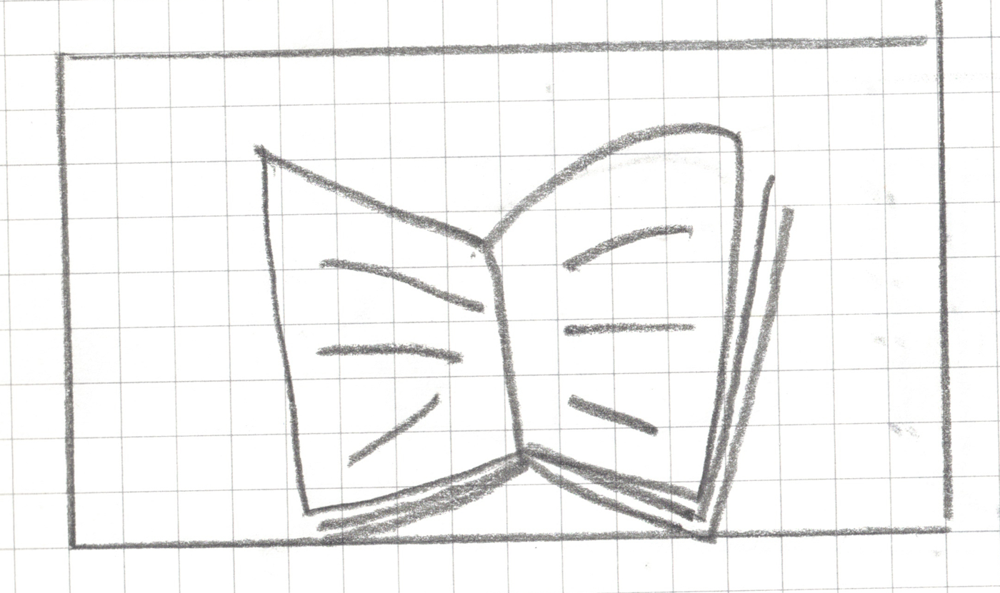
```

:::

`actual_class` = open

## Image 7

::: {style="text-align: center;"}

```{r}
#| fig-align: center
#| out-width: 60%
#| fig-alt: A pixel art design drawn in pencil on a 16x9 graph paper grid. Columns and rows are not labeled but for the purposes of this alt text assume that the columns are labeled a-p, rows 1-9. The irregular shape consists of various shades of gray pencil markings, with some internal white (unshaded) cells. Shaded cells include d2, k2, l2, m2, d3, e3, f3, i3, j3, m3, d4, e4, g4, h4, i4, j4, k4, l4, m4, n4, d5, f5, g5, h5,i5, m5, d6, e6, f6, g6, h6, j6, k6, l6, m6, e7, g7, i7, j7, k7, l7, m7, e8, f8, h8, i8, j8, k8, l8, m8, e9, f9, g9, h9, j9, k9, l9.

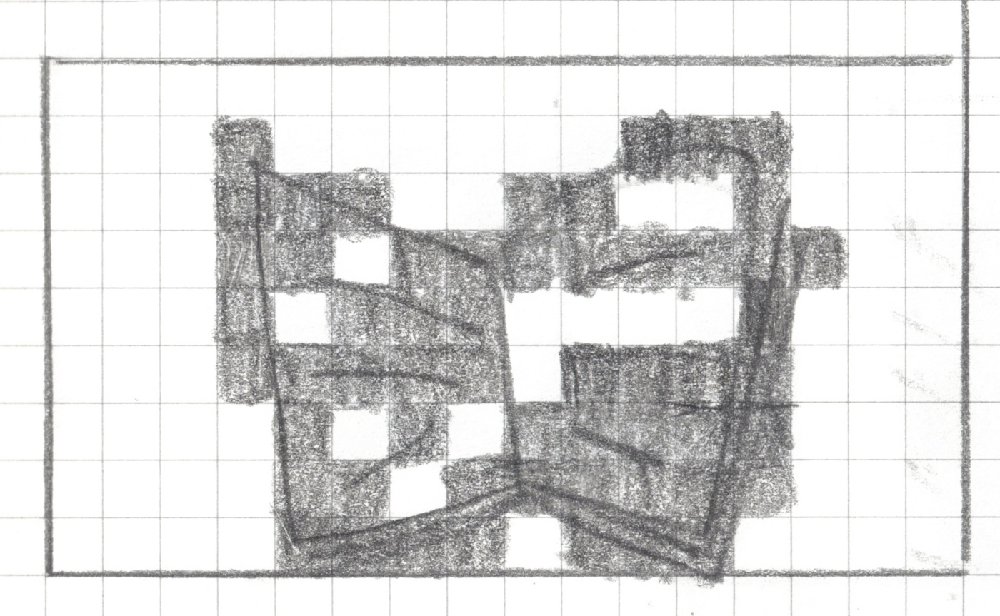
```

:::

`predicted_class` = ?

## Image 8

::: {style="text-align: center;"}

```{r}
#| fig-align: center
#| out-width: 60%
#| fig-alt: an open book viewed from a direct, front-facing perspective. The book is split symmetrically down the middle by a straight vertical line indicating the spine.
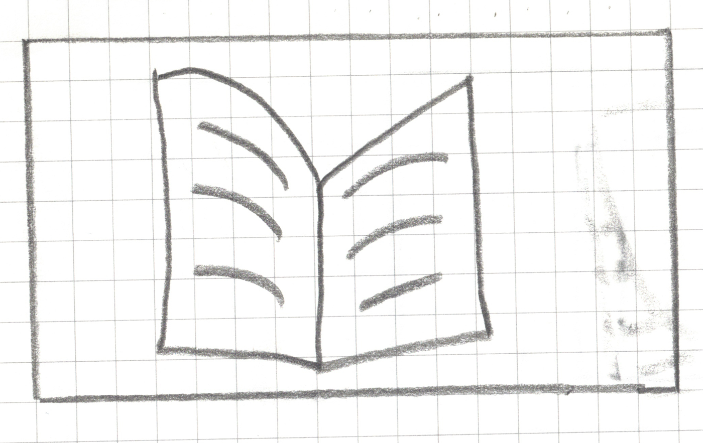
```

:::

`actual_class` = open

## Image 8

::: {style="text-align: center;"}

```{r}
#| fig-align: center
#| out-width: 60%
#| fig-alt: A pixel art design drawn in pencil on a 16x9 graph paper grid. Columns and rows are not labeled but for the purposes of this alt text assume that the columns are labeled a-p, rows 1-9. The irregular shape consists of various shades of gray pencil markings, with some internal white (unshaded) cells. Shaded cells include d1, e1, d2, f2, j2, k2, d3, e3, f3, g3, i3, j3, k3, d4, e4, g4 h4, i4, j4, k4, d5, f5, h5, i5, j5, k5, d6, e6, f6, i6, l6, d7, f7, g7, h7, i7, j7, l7, d8, e8, f8, h8, j8, k8, l8 , g9, h9, i9
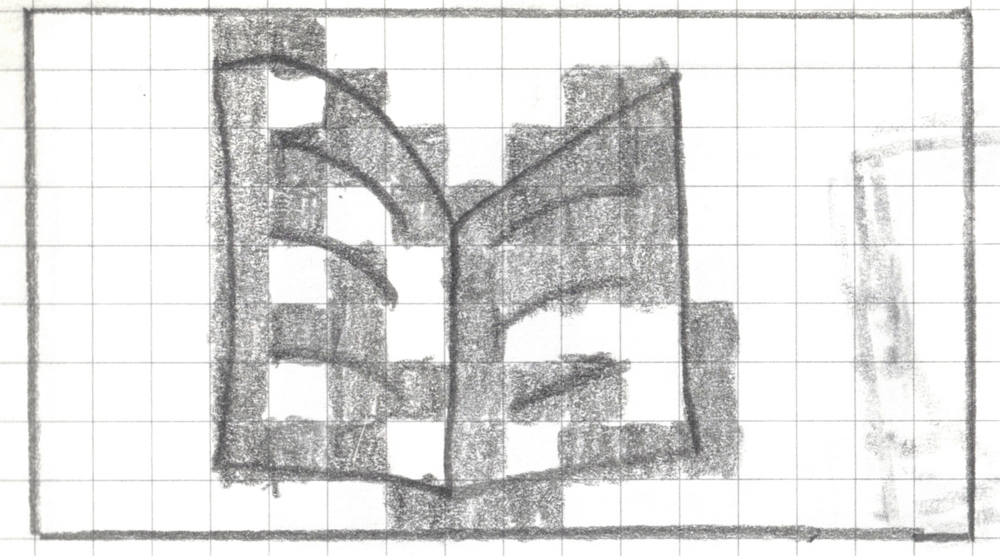
```

:::


`predicted_class` = ?

## Image 9

::: {style="text-align: center;"}

```{r}
#| fig-align: center
#| out-width: 60%
#| fig-alt: an open book or journal viewed from a three-quarter perspective, tilted slightly to the right. The book is split by a central line for the spine, with both pages completely blank inside. Along the bottom edge of the spine, a small U-shaped loop curves downward.
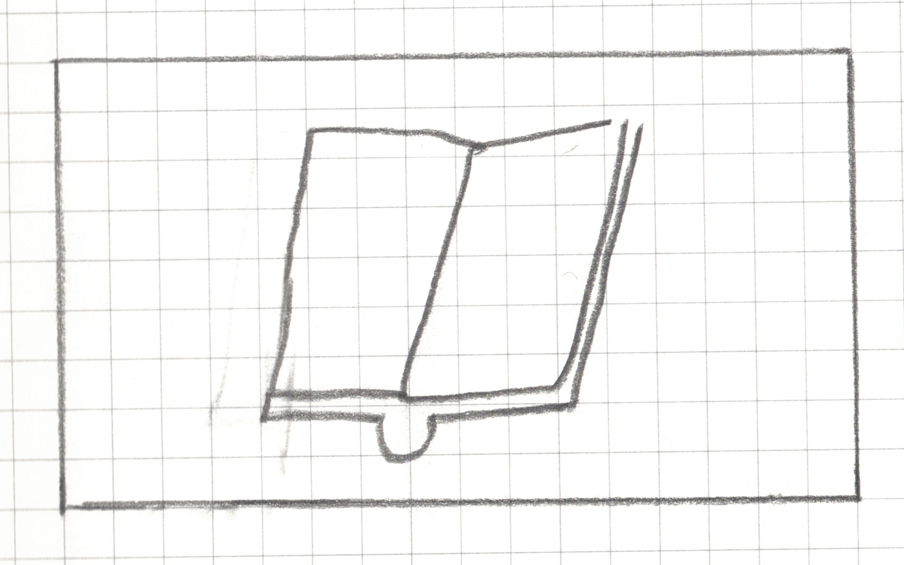
```

:::

`actual_class` = open

## Image 9

::: {style="text-align: center;"}

```{r}
#| fig-align: center
#| out-width: 60%
#| fig-alt: A pixel art design drawn in pencil on a 16x9 graph paper grid. Columns and rows are not labeled but for the purposes of this alt text assume that the columns are labeled a-p, rows 1-9. The irregular shape consists of various shades of gray pencil markings, with some internal white (unshaded) cells. Shaded cells include f2, g2, h2, i2, j2, k2, l2, e3, f3, i3, l3, e4, h4, k4, l4, e5, h5, k5, e6, h6, k6, e7, f7, g7, i7, j7, k7, e8, f8, g8, h8, i8, j8, k8
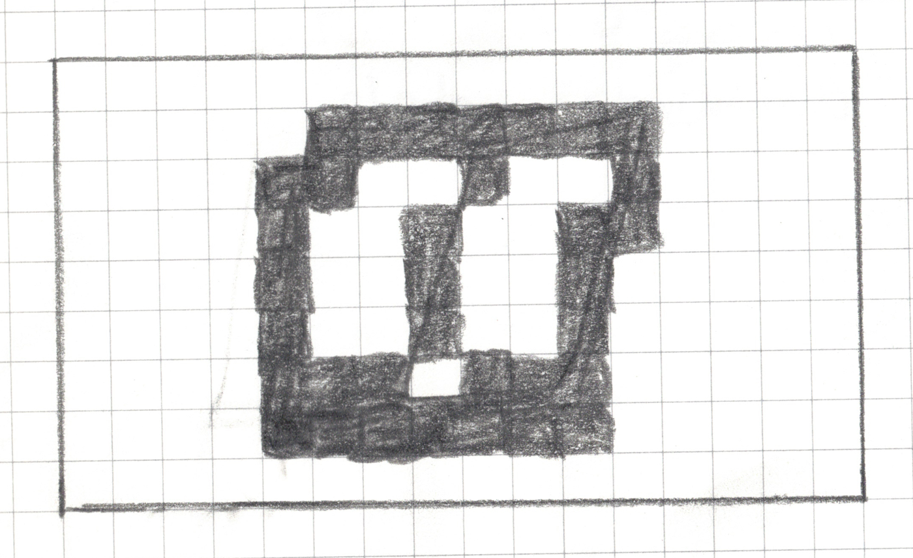
```

:::

`predicted_class` = ?

## Image 10

::: {style="text-align: center;"}

```{r}
#| fig-align: center
#| out-width: 60%
#| fig-alt: Outline of an open book, rendered from an angled perspective that tilts slightly away and down. The image is formed using basic geometric shapes, two blank, adjoining four-sided panels that share a slanted central line for the spine.

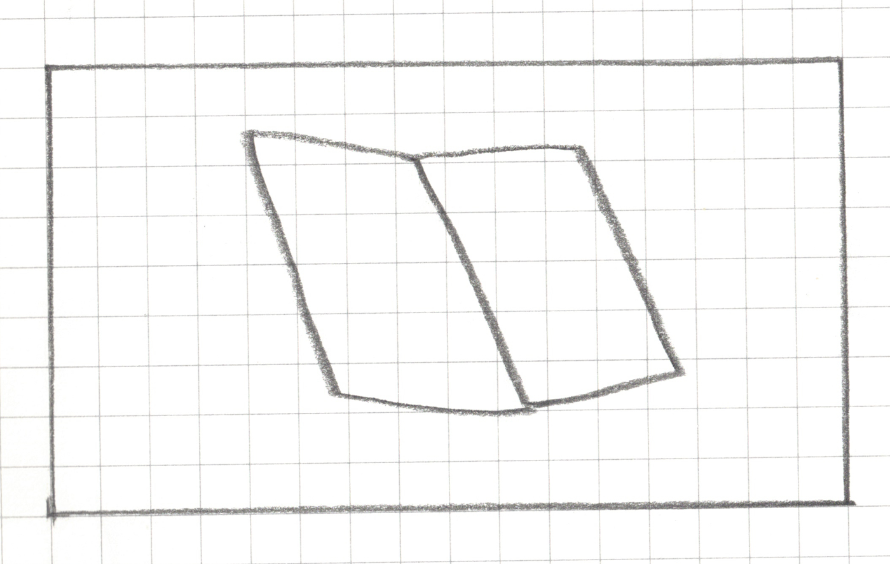
```

:::

`actual_class` = open

## Image 10

::: {style="text-align: center;"}

```{r}
#| fig-align: center
#| out-width: 60%
#| fig-alt: A pixel art design drawn in pencil on a 16x9 graph paper grid. Columns and rows are not labeled but for the purposes of this alt text assume that the columns are labeled a-p, rows 1-9. The irregular shape consists of various shades of gray pencil markings, with some internal white (unshaded) cells. Shaded cells include e2, f2, g2, h2, i2, j2, k2, e3, h3, l3, e4, i4, l4, e5, i5, l5, f6, i6, j6, m6, f7, g7, h7, i7, j7, k7, l7, m7
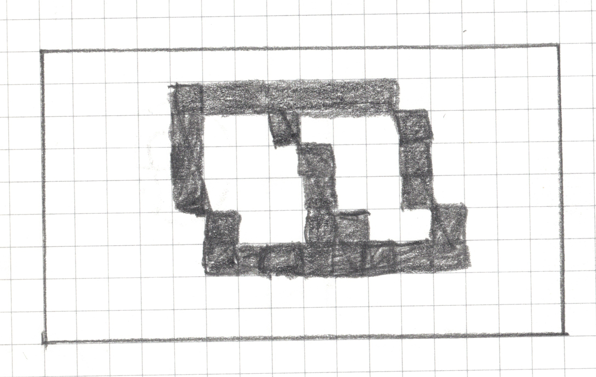
```

:::

`predicted_class` = ?

## Model Evaluation

|Criteria | **Predicted: OPEN** | **Predicted: CLOSED** |
| :--- | :--- | :--- |
| **Actual: OPEN** | <span style="color:green; font-weight:bold;">_________</span><br/>**(True Positive)** | <span style="color:orange; font-weight:bold;">________</span><br/>**(False Negative)** |
| **Actual: CLOSED**| <span style="color:red; font-weight:bold;">_______</span><br/>**(False Positive)** | <span style="color:green; font-weight:bold;">________</span><br/>**(True Negative)** |

**Accuracy** = (TP + TN) / total = ____

## Discuss

In a medical test, which one has worse consequences, a false negative or a false positive? Discuss the implications of both.

## Algorithm vs. Model

::: {.nonincremental}

- **Algorithm** = a sewing pattern (step-by-step instructions)
- **Model** = the finished jacket, made with the pattern **and** specific measurements (data)

:::

## Training a Model

Consider a clothing store who made a jacket that fits perfectly on their fashion models.

::: {style="text-align: center;"}


```{r}
#| echo: false
#| out-width: 55%
#| fig-align: center
#| fig-alt: Illustration of 3 male looking models on a runway in exact same jacket, belt, pants, and shoes. 
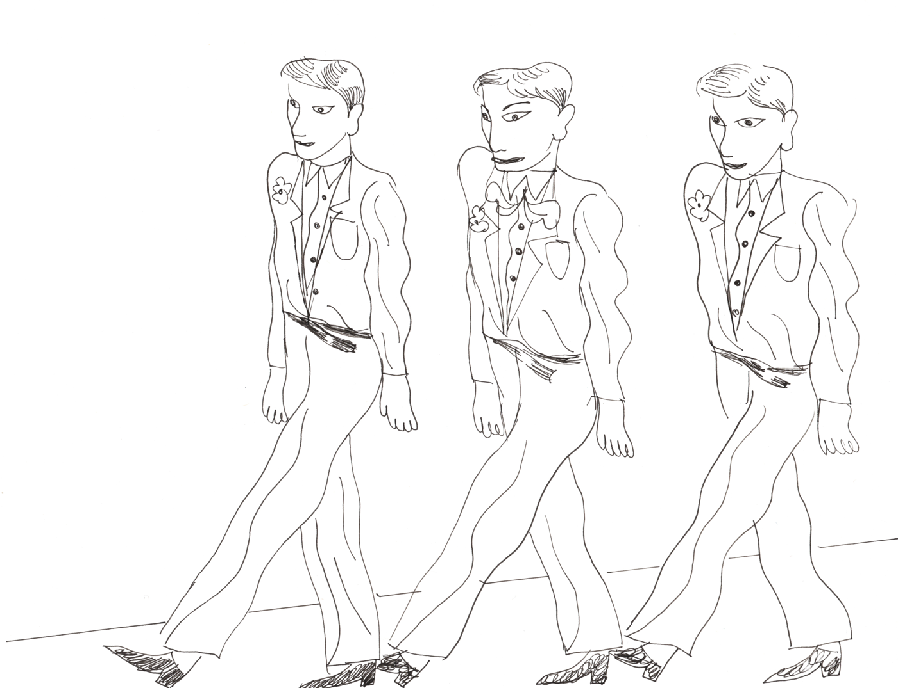
```

:::

## Testing a Model


When it comes to selling this jacket, they run into an issue. Can you identify the problem?

::: {style="text-align: center;"}


```{r}
#| echo: false
#| out-width: 55%
#| fig-align: center
#| fig-alt: The same jacket and pants worn by three different people with very different body types. The middle figure is tall, hence the jacket arms and pants legs are too short for them, the righ figure is short and the jacket arms and pants legs are too large for them. 
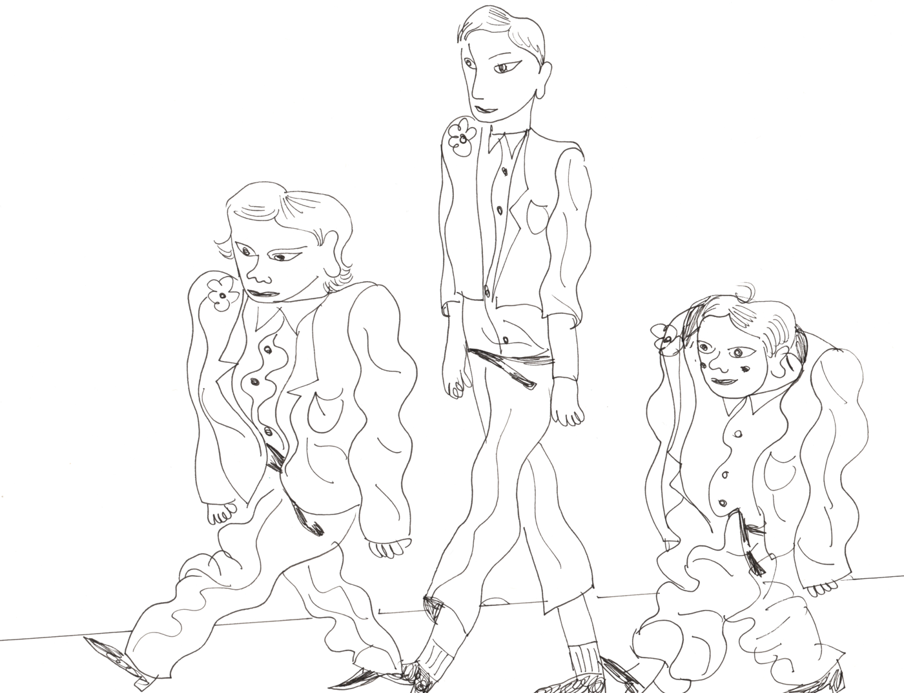
```

:::

## Training vs. Testing

::: {.nonincremental}

- **Training:** use the algorithm with the data at hand to build the model. The pattern says "stitch the arms"; the data decide how long they are.
- **Testing:** check whether the model fits **new** data.
- A model tailored too closely to its training data is **overfit**: it does not **generalize**.

:::

## Key Takeaways

1. **Computers see data, not pictures.** A drawing becomes a grid of 0s and 1s.
2. **An algorithm is a set of rules.** A **model** is what we get when we train it on data.
3. **No model is perfect.** "All models are wrong, but some are useful." (George Box)
4. **Evaluation is crucial.** Test on unseen data to find false positives and false negatives.
