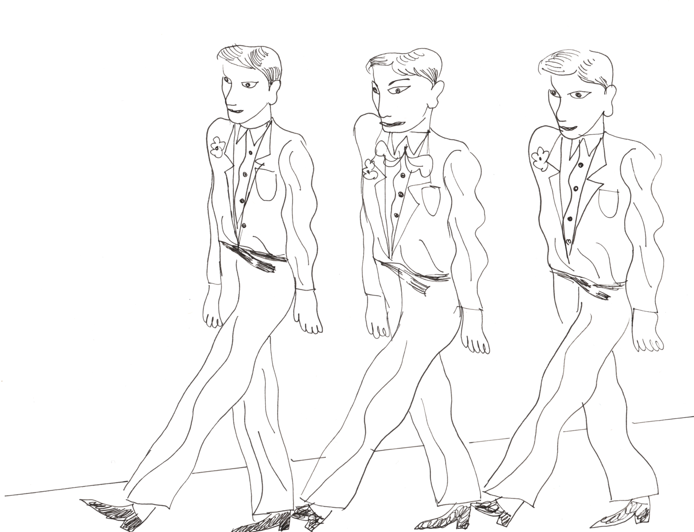
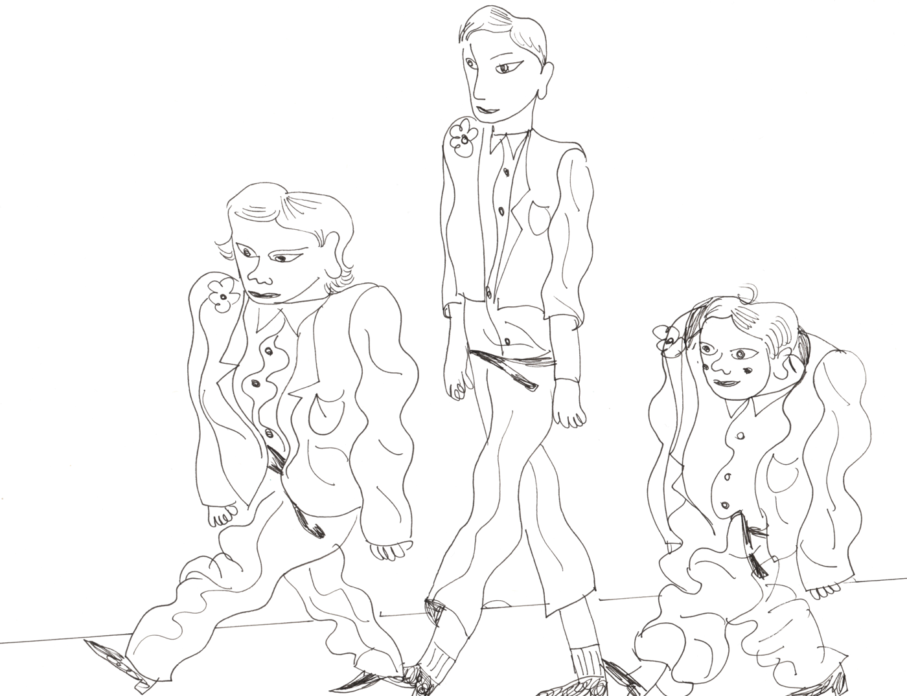

<!--
Lecture 12A (Monday): frequentist day. Model evaluation (Bayes Rules! Ch 10's
three questions: how fair, how wrong, how accurate) with lm() and openintro
babies (plus mammals for the log transformation), then multiple linear
regression, adjusted R-squared, overfitting, training and testing, and
Occam's razor. Wednesday (12B) does the same for Bayesian models with bikes
and only recaps the evaluation ideas. The jacket images are reused from the
10b-extra statistical learning activity.
-->

```{r}
#| echo: false
#| message: false
library(tidyverse)
library(openintro)
library(broom)
library(patchwork)
library(rsample)
options(scipen = 999)

source("R/plot-normal.R")

green <- hds_colors[["green"]]
pink <- hds_colors[["pink"]]

theme_set(theme_minimal(base_size = 22))

f1 <- function(x) sprintf("%.1f", x)
f2 <- function(x) sprintf("%.2f", x)
f3 <- function(x) sprintf("%.3f", x)
f0 <- function(x) format(round(x), big.mark = ",")
```

# Is our model any good? {.inverse background-color="#A51C30"}

## Our model from last week

```{r}
model_g <- lm(bwt ~ gestation, data = babies)
```

Birth weight (oz) and gestation (days) of babies born in the East Bay, 1960–1967.

. . .

We can fit a model. But is it a __good__ model?

Today: how to evaluate a regression model, and how to use __more than one__ explanatory variable. Everything today is __frequentist__. On Wednesday, we do the same for __Bayesian__ models.

## Three questions

> All models are wrong, but some are useful. (George Box)

To evaluate a model, we ask:

1. __How fair is the model?__
2. __How wrong is the model?__
3. __How accurate are the model's predictions?__

<small>These three questions come from Johnson, Ott, & Dogucu (2022), [*Bayes Rules!*](https://www.bayesrulesbook.com/chapter-10), Chapter 10. They work for both frequentist and Bayesian models.</small>

# How fair is the model? {.inverse background-color="#A51C30"}

## Questions to ask

- How was the data collected?
- By whom, and for what purpose?
- How might the results of the analysis, or the data collection itself, impact individuals and society?
- What biases or power structures might be baked into this analysis?

. . .

These questions are not answered with R code. They are answered by __thinking__ about the context.

## Baby weights {.smaller}

The `babies` data come from the Child Health and Development Studies: pregnant women in the Kaiser Foundation Health Plan in the East Bay (San Francisco area), 1960–1967.

::: {.stat-callout .discussion}
**Discussion**

With your neighbor, discuss the four questions for the `babies` data.

- Who is in the data? Who might be missing?
- Our model from last Monday says babies of mothers who smoked weighed less, on average. Who could use this result, and how?
- Would it be fair to use a model fit to these babies for babies born today? For babies born somewhere else?
:::

# How wrong is the model? {.inverse background-color="#A51C30"}

## What does our model assume?

$$Y_i = \beta_0 + \beta_1 X_i + \epsilon_i \qquad \epsilon_i \sim N(0, \sigma^2)$$

. . .

The model makes four assumptions (__LINE__):

- **L**inearity: the relationship between $X$ and $Y$ is linear.
- **I**ndependence: the observations are independent of each other.
- **N**ormality: the errors are normally distributed around the line.
- **E**qual variance: the errors have the same spread for all values of $X$.

. . .

On Wednesday, we will see that Bayesian regression makes the same assumptions.

## Independence

Two observations are __independent__ if knowing one tells us nothing extra about the other.

. . .

Observations are often __not__ independent when they come in groups or in a sequence:

- __Clusters:__ patients in the same hospital or students in the same class tend to be more alike than two random people.
- __Time:__ measurements one after another (today and tomorrow) tend to be similar.

. . .

Independence is about how the data were __collected__. We check it by thinking, not with a plot.

## Independence: babies

Each row of `babies` is a different baby. That alone does __not__ make the observations independent.

. . .

The babies were born at a few Kaiser hospitals. If babies born at the same hospital are more alike (same doctors, same neighborhoods, same care), then they are __clustered__ within hospitals, and two babies from the same hospital are not independent.

. . .

::: {.stat-callout .discussion}
**Discussion**

What else could make some babies in the data more alike than two randomly chosen babies?
:::

## Fitted values and residuals

For each observation $i$:

- The __fitted value__, $\hat{y}_i$, is the value on the line at $x_i$: the $y$ the model expects for that $x$.
- The __residual__, $e_i = y_i - \hat{y}_i$, is observed minus fitted: how far the point is from the line.

. . .

## Fitted values and residuals in R

`augment()` from the {broom} package adds both to the data: `.fitted` is $\hat{y}_i$ and `.resid` is $e_i$.

```{r}
model_g_aug <- augment(model_g)
model_g_aug |>
  select(bwt, gestation, .fitted, .resid) |>
  head(3)
```

For the first baby: $y_1 = 120$, $\hat{y}_1 = `r f2(model_g_aug$.fitted[1])`$, so $e_1 = 120 - `r f2(model_g_aug$.fitted[1])` = `r f2(model_g_aug$.resid[1])`$ ounces.

## Residuals vs. fitted values

```{r}
#| fig-height: 4.2
#| fig-width: 10
#| fig-align: center
#| fig-alt: "Scatterplot of the residuals of the birth weight model against the fitted values, with a dashed horizontal line at 0. The points form a shapeless cloud centered at 0 with roughly the same spread from left to right, except for a few points with small fitted values."
ggplot(model_g_aug, aes(x = .fitted, y = .resid)) +
  geom_point(alpha = 0.4) +
  geom_hline(yintercept = 0, linetype = "dashed")
```

Each point is one baby: its fitted value $\hat{y}_i$ (x-axis) and its residual $e_i$ (y-axis). We want a __shapeless cloud__ around 0: no curve (**L**inearity) and the same spread everywhere (**E**qual variance).

## Histogram of residuals

```{r}
#| fig-height: 4
#| fig-width: 10
#| fig-align: center
#| fig-alt: "Histogram of the residuals of the birth weight model. It is unimodal, centered at 0, and roughly symmetric and bell shaped, with a few residuals far below 0."
ggplot(model_g_aug, aes(x = .resid)) +
  geom_histogram(binwidth = 5, fill = green, color = "white")
```

We want it to look roughly **N**ormal: unimodal, symmetric, centered at 0.

## What does "wrong" look like?

```{r}
#| echo: false
#| fig-height: 4.6
#| fig-width: 14
#| fig-align: center
#| fig-alt: "Three residual vs fitted plots made with simulated data. Left, labeled good: a shapeless cloud around 0. Middle, labeled not linear: the residuals form a U shape, positive at both ends and negative in the middle. Right, labeled not equal variance: a fan shape, with residuals close to 0 on the left and spread out on the right."
set.seed(84735)
n <- 200
sim <- tibble(x = runif(n, 0, 10)) |>
  mutate(good = 2 + 3 * x + rnorm(n, 0, 3),
         curved = 2 + 0.6 * (x - 5)^2 + x + rnorm(n, 0, 1.5),
         fan = 2 + 3 * x + rnorm(n, 0, 0.5 + 0.8 * x))
resid_plot <- function(y, title) {
  m <- lm(sim[[y]] ~ sim$x)
  tibble(fitted = fitted(m), resid = resid(m)) |>
    ggplot(aes(fitted, resid)) +
    geom_point(alpha = 0.5) +
    geom_hline(yintercept = 0, linetype = "dashed") +
    labs(title = title, x = "fitted", y = "residual") +
    theme(axis.text = element_blank())
}
resid_plot("good", "Good") | resid_plot("curved", "Not linear") | resid_plot("fan", "Not equal variance")
```

. . .

When the conditions are not met, the estimates, p-values, and intervals may not be trustworthy. Sometimes a __transformation__ helps.

## Brain and body weight of mammals

```{r}
#| echo: false
mammals <- openintro::mammals
```

```{r}
#| fig-height: 4
#| fig-width: 10
#| fig-align: center
#| fig-alt: "Scatterplot of brain weight in grams against body weight in kilograms for 62 mammals. Almost all points are crowded in the bottom left corner; two points (the elephants) are far to the right and far up, near 2,500 to 6,700 kilograms and 4,600 to 5,700 grams."
ggplot(mammals, aes(x = body_wt, y = brain_wt)) +
  geom_point()
```

<small>Data: [mammals](https://openintrostat.github.io/openintro/reference/mammals.html) in the `openintro` package: `r nrow(mammals)` mammal species; body weight (kg) and brain weight (g).</small>

## A linear model on the original scale

```{r}
#| echo: false
model_raw <- lm(brain_wt ~ body_wt, data = mammals)
```

```{r}
#| echo: false
#| fig-height: 4.4
#| fig-width: 12
#| fig-align: center
#| fig-alt: "Two plots for the model of brain weight on body weight. Left: the scatterplot with the least squares line; the line is pulled by the two elephants and misses most of the small mammals. Right: the residual vs fitted plot; most points are crowded at the left near 0, a few are spread widely, and the spread grows with the fitted values."
p1 <- ggplot(mammals, aes(body_wt, brain_wt)) +
  geom_point() +
  geom_smooth(method = "lm", se = FALSE, color = green) +
  labs(title = "Data and line")
p2 <- augment(model_raw) |>
  ggplot(aes(.fitted, .resid)) +
  geom_point() +
  geom_hline(yintercept = 0, linetype = "dashed") +
  labs(title = "Residuals vs. fitted")
p1 | p2
```

::: {.stat-callout .exercise}
**Exercise**

Which conditions do not look reasonable?
:::

## Log transformation

When a variable is __right-skewed__ (a few very large values), taking its __log__ spreads out the small values and pulls in the large ones. `log()` in R is the natural log.

```{r}
mammals <- mammals |>
  mutate(log_body = log(body_wt),
         log_brain = log(brain_wt))
```

```{r}
#| echo: false
#| fig-height: 3.6
#| fig-width: 12
#| fig-align: center
#| fig-alt: "Two histograms of mammal body weight. Left, on the original scale: extremely right skewed, with almost all values in the first bar. Right, the log of body weight: roughly symmetric, from about -5 to 9."
h1 <- ggplot(mammals, aes(body_wt)) +
  geom_histogram(bins = 20, fill = green, color = "white") +
  labs(title = "body_wt")
h2 <- ggplot(mammals, aes(log_body)) +
  geom_histogram(bins = 20, fill = green, color = "white") +
  labs(title = "log(body_wt)")
h1 | h2
```

## A linear model on the log scale

```{r}
model_log <- lm(log_brain ~ log_body, data = mammals)
```

```{r}
#| echo: false
#| fig-height: 4.2
#| fig-width: 12
#| fig-align: center
#| fig-alt: "Two plots for the model of log brain weight on log body weight. Left: a strong linear relationship with the least squares line going through the middle of the points. Right: the residual vs fitted plot is a shapeless cloud around 0 with similar spread from left to right."
p3 <- ggplot(mammals, aes(log_body, log_brain)) +
  geom_point() +
  geom_smooth(method = "lm", se = FALSE, color = green) +
  labs(title = "Data and line (log scale)")
p4 <- augment(model_log) |>
  ggplot(aes(.fitted, .resid)) +
  geom_point() +
  geom_hline(yintercept = 0, linetype = "dashed") +
  labs(title = "Residuals vs. fitted")
p3 | p4
```

Much better!

## Predicting on the log scale

```{r}
#| echo: false
tidy_log <- tidy(model_log)
l0 <- round(tidy_log$estimate[1], 2)
l1 <- round(tidy_log$estimate[2], 2)
man <- mammals |> filter(species == "Man")
e_l0 <- exp(l0)
pred_man <- round(e_l0, 1) * man$body_wt^l1
```

```{r}
tidy(model_log)
```

$$\widehat{\log(\text{brain})} = `r l0` + `r l1` \times \log(\text{body})$$

. . .

On the log scale: as the log of body weight increases by 1 unit, the log of brain weight is expected to increase by `r l1` units.

. . .

But nobody thinks in "log kilograms" or "log grams"! Let's go back to kilograms and grams.

## Undoing the logs

Start from $\log(\text{brain}) = `r l0` + `r l1` \times \log(\text{body})$. Raise $e$ to the power of both sides. Since $e^{\log(a)} = a$:

$$\text{brain} = e^{`r l0` + `r l1` \times \log(\text{body})}$$

. . .

Since $e^{a + b} = e^{a} \times e^{b}$:

$$\text{brain} = e^{`r l0`} \times e^{`r l1` \times \log(\text{body})}$$

. . .

Since $e^{`r l0`} \approx `r f1(e_l0)`$ and $e^{c \times \log(a)} = a^{c}$:

$$\text{brain} = `r f1(e_l0)` \times \text{body}^{`r l1`}$$

## Back to grams and kilograms

$$\widehat{\text{brain}} = `r f1(e_l0)` \times \text{body}^{`r l1`}$$

```{r}
#| echo: false
#| fig-height: 3.4
#| fig-width: 10
#| fig-align: center
#| fig-alt: "Scatterplot of brain weight in grams against body weight in kilograms for the 62 mammals, with the curve brain = 8.4 times body to the power 0.75. The curve rises steeply at first and then more slowly. It passes close to most mammals and to the largest elephant, at about 6,700 kilograms, and well below the other elephant, at about 2,500 kilograms and 4,600 grams."
ggplot(mammals, aes(body_wt, brain_wt)) +
  geom_point() +
  geom_function(fun = function(x) e_l0 * x^l1, color = green, linewidth = 1.3, n = 1000) +
  labs(x = "body weight (kg)", y = "brain weight (g)")
```

On the original scale, this is a __curve__, not a line. So "one more kilogram" does not always mean the same change in grams. Instead, we think in __multiplying__: if body weight doubles, the expected brain weight is multiplied by $2^{`r l1`} \approx `r f2(2^l1)`$, so it is about `r round(100 * (2^l1 - 1))`% heavier.

## Prediction: a man

The man in the data (listed as "Man") weighs `r man$body_wt` kg.

$$\widehat{\text{brain}} = `r f1(e_l0)` \times `r man$body_wt`^{`r l1`} \approx `r f0(pred_man)` \text{ grams}$$

. . .

The man's actual brain weighs `r format(man$brain_wt, big.mark = ",")` grams. The residual is

$$e = y - \hat{y} = `r format(man$brain_wt, big.mark = ",")` - `r f0(pred_man)` = `r f0(man$brain_wt - pred_man)` \text{ grams}$$

## The man's residual

```{r}
#| echo: false
#| fig-height: 4.6
#| fig-width: 11
#| fig-align: center
#| fig-alt: !expr glue::glue("Scatterplot of brain weight in grams against body weight in kilograms for mammals up to 300 kilograms, with the curve brain = {f1(e_l0)} times body to the power {l1}. Most mammals are close to the curve. The man, labeled and shown as a large pink point at 62 kilograms and {format(man$brain_wt, big.mark = ',')} grams, is far above the curve. A dashed pink segment connects the man to the curve at about {f0(pred_man)} grams.")
ggplot(mammals, aes(body_wt, brain_wt)) +
  geom_point(alpha = 0.6) +
  geom_function(fun = function(x) e_l0 * x^l1, color = green, linewidth = 1.3, n = 1000) +
  annotate("segment", x = man$body_wt, xend = man$body_wt,
           y = e_l0 * man$body_wt^l1, yend = man$brain_wt,
           color = pink, linewidth = 1, linetype = "dashed") +
  annotate("point", x = man$body_wt, y = man$brain_wt, color = pink, size = 5) +
  annotate("label", x = man$body_wt + 35, y = man$brain_wt, label = "man", size = 7) +
  coord_cartesian(xlim = c(0, 300), ylim = c(0, 1500)) +
  labs(x = "body weight (kg)", y = "brain weight (g)")
```

The residual is positive and large: men have a much bigger brain than expected for a mammal of their size.

<small>Zoomed in to mammals up to 300 kg.</small>

## Prediction in R: the log scale

`predict()` (from the {stats} package, which comes with R) plugs new values of $x$ into a fitted model.

- `newdata` is a data frame with the new $x$ values. Its column must have the __same name__ as the explanatory variable in the model: here `log_body`, so we give it `log(62)`.

. . .

```{r}
predict(model_log, newdata = tibble(log_body = log(62)))
```

```{r}
#| echo: false
pred_log_62 <- predict(model_log, newdata = tibble(log_body = log(62)))
```

The model's response is `log_brain`, so this is the prediction on the __log__ scale: $\widehat{\log(\text{brain})} \approx `r f2(pred_log_62)`$.

## Prediction in R: back to grams

`exp()` undoes `log()` and takes us back to grams:

```{r}
predict(model_log, newdata = tibble(log_body = log(62))) |>
  exp()
```

<small>`r f0(exp(pred_log_62))` instead of `r f0(pred_man)`: R uses the unrounded estimates (`r sprintf("%.4f", coef(model_log)[1])` and `r sprintf("%.4f", coef(model_log)[2])`), while we rounded them to `r l0` and `r l1`.</small>

# How accurate are the predictions? {.inverse background-color="#A51C30"}

## Correlation

The __correlation__, $r$, measures the __strength__ and __direction__ of the __linear__ relationship between two numerical variables. It is always between $-1$ and $1$.

```{r}
#| echo: false
#| fig-height: 3.6
#| fig-width: 14
#| fig-align: center
#| fig-alt: "Five simulated scatterplots with correlations -0.9, -0.5, 0, 0.5, and 0.9. At -0.9 the points fall tightly around a downward line; at -0.5 the downward trend is loose; at 0 there is no trend; at 0.5 the upward trend is loose; at 0.9 the points fall tightly around an upward line."
set.seed(84735)
rs <- c(-0.9, -0.5, 0, 0.5, 0.9)
map_dfr(rs, function(r) {
  x <- rnorm(150)
  tibble(r = r, x = x, y = r * x + sqrt(1 - r^2) * rnorm(150))
}) |>
  mutate(label = paste("r =", r), label = fct_inorder(label)) |>
  ggplot(aes(x, y)) +
  geom_point(alpha = 0.5, size = 1.5) +
  facet_wrap(~label, nrow = 1) +
  theme(axis.text = element_blank(), axis.title = element_blank(),
        strip.text = element_text(size = 20))
```

- The sign gives the direction (positive or negative).
- The closer to $-1$ or $1$, the stronger. $r = 0$: no __linear__ relationship.

## Correlation in R

```{r}
cor(babies$gestation, babies$bwt, use = "complete.obs")
```

```{r}
#| echo: false
r_g <- cor(babies$gestation, babies$bwt, use = "complete.obs")
```

`gestation` has some missing values. `cor()` does not have `na.rm`; `use = "complete.obs"` tells it to use only the babies with no missing values.

. . .

::: {.stat-callout .note-tip}
**Careful**

A correlation near 0 does not mean there is no relationship: there could be a strong *curved* relationship. Correlation only measures *linear* relationships. Always plot the data!
:::

## Where do b₀ and b₁ come from?

The least squares estimates (the ones `lm()` gives) can be calculated from five summary statistics:

$$b_1 = r \times \frac{s_y}{s_x} \qquad\qquad b_0 = \bar{y} - b_1 \bar{x}$$

```{r}
babies |>
  summarize(mean_x = mean(gestation, na.rm = TRUE), sd_x = sd(gestation, na.rm = TRUE),
            mean_y = mean(bwt, na.rm = TRUE), sd_y = sd(bwt, na.rm = TRUE))
```

```{r}
#| echo: false
st <- babies |>
  summarize(mean_x = mean(gestation, na.rm = TRUE), sd_x = sd(gestation, na.rm = TRUE),
            mean_y = mean(bwt, na.rm = TRUE), sd_y = sd(bwt, na.rm = TRUE))
b1_hand <- r_g * st$sd_y / st$sd_x
b0_hand <- st$mean_y - b1_hand * st$mean_x
```

## Calculating b₀ and b₁

$$b_1 = r \times \frac{s_y}{s_x} = `r f3(r_g)` \times \frac{`r f2(st$sd_y)`}{`r f2(st$sd_x)`} = `r f3(b1_hand)`$$

$$b_0 = \bar{y} - b_1 \bar{x} = `r f2(st$mean_y)` - `r sprintf("%.4f", b1_hand)` \times `r f2(st$mean_x)` = `r f1(b0_hand)`$$

These are the estimates from `tidy(model_g)` last week: $b_0 = -10.1$ and $b_1 = 0.464$.

## What these formulas tell us

$$b_1 = r \times \frac{s_y}{s_x} \qquad\qquad b_0 = \bar{y} - b_1 \bar{x}$$

- Standard deviations are always positive, so the slope has the __same sign__ as the correlation.
- Rearranging the second formula, $\bar{y} = b_0 + b_1 \bar{x}$: the line always goes through the point $(\bar{x}, \bar{y})$.

## Residuals measure prediction error

Each residual $e_i = y_i - \hat{y}_i$ is a prediction error. __Root mean squared error (RMSE)__: square the residuals, take the mean, then the square root.

$$\text{RMSE} = \sqrt{\frac{1}{n}\sum e_i^2}$$

```{r}
model_g_aug |>
  summarize(rmse = sqrt(mean(.resid^2)))
```

```{r}
#| echo: false
rmse_g <- sqrt(mean(model_g_aug$.resid^2))
```

Our predictions of birth weight are typically off by about `r f1(rmse_g)` ounces. RMSE is in the units of $y$.

## Variability in birth weight

```{r}
#| echo: false
#| fig-height: 4
#| fig-width: 13
#| fig-align: center
#| fig-alt: "Two plots of birth weight against gestation for 60 randomly chosen babies. Left, labeled total variability: a horizontal line at the mean birth weight with vertical segments from each point to it. Right, labeled left over after the model: the regression line with vertical segments from each point to the line. The segments on the right are only a little shorter than on the left."
set.seed(84735)
few <- model_g_aug |> slice_sample(n = 60)
ybar <- mean(babies$bwt)
v1 <- ggplot(few, aes(gestation, bwt)) +
  geom_segment(aes(xend = gestation, yend = ybar), color = pink, linewidth = 0.9) +
  geom_hline(yintercept = ybar, color = "gray30", linewidth = 1) +
  geom_point() +
  labs(title = "Total variability: around the mean")
v2 <- ggplot(few, aes(gestation, bwt)) +
  geom_segment(aes(xend = gestation, yend = .fitted), color = pink, linewidth = 0.9) +
  geom_abline(intercept = coef(model_g)[1], slope = coef(model_g)[2], color = green, linewidth = 1) +
  geom_point() +
  labs(title = "Left over: around the line")
(v1 | v2) & theme(plot.title = element_text(size = 20))
```

- __Left:__ each pink segment is $y_i - \bar{y}$, how far a baby is from the __mean__ birth weight. This is the variability if we do not use gestation.
- __Right:__ each pink segment is the residual $e_i = y_i - \hat{y}_i$, how far a baby is from the __line__. This is the variability left over after using gestation.

## What do the two plots tell us?

```{r}
#| echo: false
ss_total <- sum((model_g_aug$bwt - mean(model_g_aug$bwt))^2)
ss_left <- sum(model_g_aug$.resid^2)
```

::: {.stat-callout .note-tip}
**Conclusion**

The segments around the line (right) are only a *little* shorter than the segments around the mean (left). Gestation explains *some* of the variability in birth weight, but *most of it is left over*.
:::

. . .

With all `r format(nrow(model_g_aug), big.mark = ",")` babies, square each segment and add them up:

- around the mean: $\sum (y_i - \bar{y})^2$ = `r format(round(ss_total), big.mark = ",")`
- around the line: $\sum e_i^2$ = `r format(round(ss_left), big.mark = ",")`, which is `r round(100 * ss_left / ss_total)`% of the total.

. . .

The model explains the other `r 100 - round(100 * ss_left / ss_total)`%. This is $R^2$.

## R²

$$R^2 = 1 - \frac{\text{variability left over (around the line)}}{\text{total variability (around the mean)}} = 1 - \frac{\sum (y_i - \hat{y}_i)^2}{\sum (y_i - \bar{y})^2}$$

```{r}
glance(model_g) |>  # glance() from {broom}: one-row model summaries
  select(r.squared)
```

```{r}
#| echo: false
r2_g <- glance(model_g)$r.squared
```

. . .

__Interpretation:__ `r round(100 * r2_g, 1)`% of the variability in birth weight is explained by gestation (with a linear model). For simple linear regression, $R^2 = r^2$: $`r f3(r_g)`^2 = `r f3(r_g^2)`$.

## R² is between 0 and 1

::: {.stat-callout .exercise}
**Exercise**

a. What would $R^2 = 0$ mean? What would $R^2 = 1$ mean?
b. Only `r round(100 * r2_g)`% of the variability in birth weight is explained by gestation. Name some other variables that could explain the rest.
c. Is a model with a low $R^2$ useless? Last Monday, the slope of gestation had a tiny p-value.
:::

## "Explains" does not mean "causes"

Gestation explains about `r round(100 * r2_g)`% of the variability in birth weight. This does __not__ mean that gestation __causes__ birth weight.

. . .

- `babies` is an __observational__ study: nobody assigned the length of pregnancy.
- Other variables, like the mother's health or smoking, could be related to both gestation and birth weight.
- Even a large $R^2$ would not change this: $R^2$ describes an __association__, not a cause.

. . .

From this model alone, we __cannot__ conclude causation.

## An average baby vs. a single baby

$\hat{y} = -10.1 + 0.464 \times 280 \approx 120$ ounces is the __expected (average)__ birth weight of babies born after 280 days. A single baby born after 280 days could weigh quite a bit more or less.

```{r}
new_baby <- tibble(gestation = 280)
predict(model_g, newdata = new_baby, interval = "confidence")
predict(model_g, newdata = new_baby, interval = "prediction")
```

```{r}
#| echo: false
ci_280 <- predict(model_g, newdata = tibble(gestation = 280), interval = "confidence")
pi_280 <- predict(model_g, newdata = tibble(gestation = 280), interval = "prediction")
```

We saw `predict()` with the mammals model. With `interval =`, it also gives an interval.

## Confidence vs. prediction intervals

- 95% __confidence interval__ (`r f1(ci_280[2])` to `r f1(ci_280[3])` oz): for the __average__ birth weight of all babies born after 280 days.
- 95% __prediction interval__ (`r f1(pi_280[2])` to `r f1(pi_280[3])` oz): for the birth weight of __one__ baby born after 280 days. It is much wider because single babies vary around the line.

```{r}
#| echo: false
#| fig-height: 3.6
#| fig-width: 11
#| fig-align: center
#| fig-alt: "Scatterplot of birth weight against gestation with the regression line. A narrow dark green band around the line shows the 95% confidence intervals for the average birth weight. A much wider light pink band with dashed pink edges shows the 95% prediction intervals for a single baby; it covers most of the points. The bands are labeled confidence, the average, and prediction, one baby."
grid_g <- tibble(gestation = seq(220, 340, by = 1))
bands <- bind_cols(grid_g,
                   predict(model_g, grid_g, interval = "confidence") |> as_tibble() |> rename(c_lwr = lwr, c_upr = upr),
                   predict(model_g, grid_g, interval = "prediction") |> as_tibble() |> select(p_lwr = lwr, p_upr = upr))
ggplot(babies, aes(gestation, bwt)) +
  geom_ribbon(data = bands, aes(x = gestation, ymin = p_lwr, ymax = p_upr), inherit.aes = FALSE, fill = pink, alpha = 0.3) +
  geom_point(alpha = 0.25) +
  geom_ribbon(data = bands, aes(x = gestation, ymin = c_lwr, ymax = c_upr), inherit.aes = FALSE, fill = green, alpha = 0.7) +
  geom_line(data = bands, aes(gestation, fit), color = green, linewidth = 1) +
  geom_line(data = bands, aes(gestation, p_lwr), color = pink, linewidth = 0.8, linetype = "dashed") +
  geom_line(data = bands, aes(gestation, p_upr), color = pink, linewidth = 0.8, linetype = "dashed") +
  annotate("label", x = 228, y = max(bands$p_upr[bands$gestation == 228]) + 8,
           label = "prediction: one baby", hjust = 0, size = 6) +
  annotate("label", x = 320, y = bands$fit[bands$gestation == 320] - 14,
           label = "confidence: the average", hjust = 0.5, size = 6) +
  coord_cartesian(xlim = c(220, 340))
```

# More than one explanatory variable {.inverse background-color="#A51C30"}

## Back to the babies

```{r}
#| echo: false
babies <- babies |> drop_na()
r2_g <- glance(lm(bwt ~ gestation, data = babies))$r.squared
```

Earlier today, gestation explained only about `r round(100 * r2_g)`% of the variability in birth weight.

Last week, we also saw that babies of mothers who smoked weighed about 8.9 ounces less, on average.

. . .

Can we use __both__ gestation and smoking in __one__ model?

## Multiple linear regression

$$y_i = \beta_0 + \beta_1 x_{1i} + \beta_2 x_{2i} + \dots + \beta_k x_{ki} + \epsilon_i$$

- $k$ explanatory variables: $x_1, x_2, \dots, x_k$
- one slope for each explanatory variable

. . .

For birth weight:

$$\text{bwt}_i = \beta_0 + \beta_1 \text{gestation}_i + \beta_2 \text{smoke}_i + \epsilon_i$$

## Missing values

Some babies are missing some variables. Today we compare models with different variables, so every model should use the __same__ babies.

```{r}
#| eval: false
babies <- babies |>
  drop_na()
```

```{r}
#| echo: false
n_babies <- nrow(babies)
```

`drop_na()` from the {tidyr} package (part of the tidyverse) keeps only the rows with no missing values. `r format(n_babies, big.mark = ",")` of the 1,236 babies are left.

## Fitting the model

In R, we add explanatory variables with `+`.

```{r}
model_gs <- lm(bwt ~ gestation + smoke, data = babies)
tidy(model_gs)
```

```{r}
#| echo: false
gs <- tidy(model_gs)
g0 <- round(gs$estimate[1], 2)
g1 <- round(gs$estimate[2], 3)
g2 <- round(gs$estimate[3], 2)
```

$$\widehat{\text{bwt}} = `r g0` + `r g1` \times \text{gestation} - `r abs(g2)` \times \text{smoke}$$

## Two parallel lines

`smoke` is 0 or 1, so the model is two lines with the same slope:

- Did not smoke (smoke = 0): $\widehat{\text{bwt}} = `r g0` + `r g1` \times \text{gestation}$
- Smoked (smoke = 1): $\widehat{\text{bwt}} = (`r g0` - `r abs(g2)`) + `r g1` \times \text{gestation}$

```{r}
#| echo: false
#| fig-height: 3.6
#| fig-width: 11
#| fig-align: center
#| fig-alt: !expr glue::glue("Scatterplot of birth weight against gestation, with points colored by whether the mother smoked. Babies of mothers who did not smoke are green dots; babies of mothers who smoked are pink crosses. Two parallel lines are drawn and labeled; the solid green line for mothers who did not smoke is about {abs(g2)} ounces above the dashed pink line for mothers who smoked.")
babies |>
  mutate(smoke = factor(smoke, labels = c("did not smoke", "smoked"))) |>
  ggplot(aes(gestation, bwt, color = smoke, shape = smoke)) +
  geom_point(alpha = 0.35) +
  geom_abline(intercept = g0, slope = g1, color = green, linewidth = 1.5) +
  geom_abline(intercept = g0 + g2, slope = g1, color = pink, linewidth = 1.5, linetype = "dashed") +
  annotate("label", x = 320, y = g0 + g1 * 320 + 14, label = "did not smoke", color = green, size = 6) +
  annotate("label", x = 320, y = g0 + g2 + g1 * 320 - 14, label = "smoked", color = pink, size = 6) +
  scale_color_manual(values = c(green, pink)) +
  scale_shape_manual(values = c(16, 4)) +
  coord_cartesian(xlim = c(220, 340)) +
  theme(legend.position = "none")
```

## Interpreting the slopes

Each slope is interpreted __holding the other variables constant__.

. . .

- __gestation:__ for babies whose mothers have the same smoking status, each additional day of gestation is associated with `r g1` ounces higher birth weight, on average.

. . .

- __smoke:__ for babies with the same gestation, babies of mothers who smoked are expected to weigh `r abs(g2)` ounces less, on average, than babies of mothers who did not smoke.

## Your turn

::: {.stat-callout .exercise}
**Exercise**

$$\widehat{\text{bwt}} = `r g0` + `r g1` \times \text{gestation} - `r abs(g2)` \times \text{smoke}$$

Predict the birth weight of a baby born after 280 days whose mother

a. did not smoke.
b. smoked.
c. What is the difference between (a) and (b)? Where is it in the model?
:::

## The smoking slope changed

```{r}
#| echo: false
s_only <- tidy(lm(bwt ~ smoke, data = babies))$estimate[2]
```

| Model | Slope of `smoke` |
|---|---|
| `bwt ~ smoke` | `r f2(s_only)` |
| `bwt ~ gestation + smoke` | `r f2(g2)` |

: Slope of smoke with and without gestation in the model

<small>Both models are fit to the same `r format(n_babies, big.mark = ",")` babies (after `drop_na()`), so the first slope is a little different from last week's.</small>

::: {.stat-callout .discussion}
**Discussion**

Why might the slope of `smoke` change when gestation is in the model? (Hint: do mothers who smoke tend to have shorter or longer pregnancies?)
:::

## Inference for each slope

```{r}
confint(model_gs)
```

```{r}
#| echo: false
ci_gs <- confint(model_gs)
```

::: {.stat-callout .exercise}
**Exercise**

Interpret the 95% confidence interval for the slope of `smoke`. Is there convincing evidence that smoking is associated with birth weight, after taking gestation into account?
:::

## Still not causal

"Holding gestation constant" sounds like an experiment, but it is not one.

. . .

- `babies` is still an __observational__ study: nobody assigned mothers to smoke or not.
- Adding gestation to the model accounts for __one__ other variable. Mothers who smoked and mothers who did not could still differ in many ways that are not in the model.

. . .

So we can say smoking is __associated__ with lower birth weight, after taking gestation into account. From this model alone, we __cannot__ conclude that smoking __causes__ lower birth weight.

# How many variables? {.inverse background-color="#A51C30"}

## More explanatory variables

```{r}
model_all <- lm(bwt ~ gestation + smoke + parity + age + height + weight,
                data = babies)
tidy(model_all)
```

<small>`parity`: 0 for a first pregnancy, 1 otherwise. `age`: mother's age (years). `height`: mother's height (inches). `weight`: mother's pre-pregnancy weight (pounds).</small>

## Interpreting the six-variable model

```{r}
#| echo: false
ht <- tidy(model_all) |> filter(term == "height")
```

::: {.stat-callout .exercise}
**Exercise**

a. Interpret the slope of `height` (`r f3(ht$estimate)`) in context.
b. Which variable does not seem to be associated with birth weight, after taking the others into account?
:::

## R² never goes down

```{r}
#| echo: false
set.seed(84735)
babies_random <- babies |> mutate(random = rnorm(n()))
model_random <- lm(bwt ~ gestation + smoke + parity + age + height + weight + random,
                   data = babies_random)
model_g <- lm(bwt ~ gestation, data = babies)
r2_tab <- tibble(model = c("gestation", "gestation + smoke",
                           "all six variables",
                           "all six + random"),
                 fit = list(model_g, model_gs, model_all, model_random)) |>
  mutate(r2 = map_dbl(fit, ~ glance(.x)$r.squared),
         adj = map_dbl(fit, ~ glance(.x)$adj.r.squared))
```

| Explanatory variables | R² |
|---|---|
| `r r2_tab$model[1]` | `r f3(r2_tab$r2[1])` |
| `r r2_tab$model[2]` | `r f3(r2_tab$r2[2])` |
| `r r2_tab$model[3]` | `r f3(r2_tab$r2[3])` |
| `r r2_tab$model[4]` | `r f3(r2_tab$r2[4])` |

: R-squared for four models of birth weight

. . .

`random` is a column of __simulated random numbers__: `mutate(random = rnorm(n()))`. It has nothing to do with birth weight, but $R^2$ still went up!

. . .

Adding a variable can never make $R^2$ smaller. So $R^2$ cannot tell us whether a variable is worth adding.

## Adjusted R²

__Adjusted $R^2$__ has a penalty for each of the $k$ explanatory variables ($n$: number of observations):

$$R^2_{adj} = 1 - \frac{\sum (y_i - \hat{y}_i)^2 / (n - k - 1)}{\sum (y_i - \bar{y})^2 / (n - 1)}$$

```{r}
glance(model_all) |>
  select(r.squared, adj.r.squared)
```

It goes up only if a new variable helps more than we would expect by chance. Use it to __compare__ models.

## R² vs. adjusted R²

| Explanatory variables | R² | Adjusted R² |
|---|---|---|
| `r r2_tab$model[1]` | `r f3(r2_tab$r2[1])` | `r f3(r2_tab$adj[1])` |
| `r r2_tab$model[2]` | `r f3(r2_tab$r2[2])` | `r f3(r2_tab$adj[2])` |
| `r r2_tab$model[3]` | `r f3(r2_tab$r2[3])` | `r f3(r2_tab$adj[3])` |
| `r r2_tab$model[4]` | `r f3(r2_tab$r2[4])` | `r f3(r2_tab$adj[4])` |

: R-squared and adjusted R-squared for four models of birth weight

## RMSE

Remember __RMSE__ (root mean squared error) from earlier today: the typical size of a residual, $e_i = y_i - \hat{y}_i$.

1. __Square__ each residual (so negative and positive errors do not cancel out).
2. Take the __mean__ of the squared residuals.
3. Take the square __root__ (to get back to the units of $y$).

$$\text{RMSE} = \sqrt{\frac{1}{n}\sum e_i^2}$$

## RMSE of the six-variable model

```{r}
augment(model_all) |>
  summarize(rmse = sqrt(mean(.resid^2)))
```

```{r}
#| echo: false
rmse_all <- sqrt(mean(residuals(model_all)^2))
```

The six-variable model's predictions are typically off by about `r f1(rmse_all)` ounces. A __smaller__ RMSE means predictions closer to the observed birth weights.

## Comparing the models

```{r}
#| echo: false
r2_tab <- r2_tab |>
  mutate(rmse = map_dbl(fit, ~ sqrt(mean(residuals(.x)^2))))
```

| Explanatory variables | Adjusted R² | RMSE (oz) |
|---|---|---|
| `r r2_tab$model[1]` | `r f3(r2_tab$adj[1])` | `r f2(r2_tab$rmse[1])` |
| `r r2_tab$model[2]` | `r f3(r2_tab$adj[2])` | `r f2(r2_tab$rmse[2])` |
| `r r2_tab$model[3]` | `r f3(r2_tab$adj[3])` | `r f2(r2_tab$rmse[3])` |
| `r r2_tab$model[4]` | `r f3(r2_tab$adj[4])` | `r f2(r2_tab$rmse[4])` |

: Adjusted R-squared and RMSE for four models of birth weight

Adjusted $R^2$: __higher__ is better. RMSE: __lower__ is better. Adding `random` did not change adjusted $R^2$, and RMSE went down by only `r sprintf("%.3f", r2_tab$rmse[3] - r2_tab$rmse[4])` ounces.


## Occam's razor

> Among models that explain the data about equally well, choose the __simpler__ one.

This principle of __parsimony__ is called __Occam's razor__, after William of Ockham, a 14th-century philosopher.

. . .

Why prefer a simpler model?

- It is easier to interpret and explain.
- To predict for a new baby, we need to collect fewer variables.
- It is less likely to be overfit.

## Which model would you choose?

| Explanatory variables | Adjusted R² | RMSE (oz) |
|---|---|---|
| gestation + smoke | `r f3(r2_tab$adj[2])` | `r f2(r2_tab$rmse[2])` |
| all six variables | `r f3(r2_tab$adj[3])` | `r f2(r2_tab$rmse[3])` |
| all six + random | `r f3(r2_tab$adj[4])` | `r f2(r2_tab$rmse[4])` |

: Adjusted R-squared and RMSE for three models of birth weight

::: {.stat-callout .discussion}
**Discussion**

Using adjusted $R^2$, RMSE, and Occam's razor, which model would you choose? Are the extra variables worth collecting? Does it depend on what the model is for?
:::


# Training and testing {.inverse background-color="#A51C30"}

## Why do we fit models?

Often, to make predictions for __new__ data: babies who are not in our data yet.

. . .

So far, we evaluated each model on the __same__ data we used to fit it. That is like a clothing store checking whether a jacket fits... on the model it was tailored for.

## A jacket made for its models

::: columns
::: {.column width="50%"}
```{r}
#| echo: false
#| fig-alt: Illustration of 3 male looking models on a runway in exact same jacket, belt, pants, and shoes.

```
__Training:__ fits perfectly.
:::

::: {.column width="50%"}
```{r}
#| echo: false
#| fig-alt: The same jacket and pants worn by three different people with very different body types. The middle figure is tall, hence the jacket arms and pants legs are too short for them, the righ figure is short and the jacket arms and pants legs are too large for them.

```
__Testing:__ new people, not a good fit.
:::
:::

## Overfitting: the 15 babies

```{r}
#| echo: false
set.seed(84735)
small <- babies |>
  filter(between(gestation, 255, 305)) |>
  slice_sample(n = 15)
rest <- babies |>
  filter(!case %in% small$case,
         between(gestation, min(small$gestation), max(small$gestation)))
m_line <- lm(bwt ~ gestation, data = small)
m_wiggly <- lm(bwt ~ poly(gestation, 9), data = small)
rmse <- function(m, d) sqrt(mean((d$bwt - predict(m, d))^2))
grid <- tibble(gestation = seq(min(small$gestation), max(small$gestation), length.out = 400)) |>
  mutate(line = predict(m_line, pick(everything())),
         wiggly = predict(m_wiggly, pick(everything())))
```

We fit two models to __`r nrow(small)` babies__: a straight line and a very wiggly curve.

```{r}
#| echo: false
#| fig-height: 4.4
#| fig-width: 13
#| fig-align: center
#| fig-alt: !expr glue::glue("Two scatterplots of the same 15 babies, birth weight against gestation. On the left, a straight line through the points. On the right, a wiggly curve that goes up and down to pass close to almost every point. The training RMSE is {f1(rmse(m_line, small))} ounces for the line and {f1(rmse(m_wiggly, small))} ounces for the wiggly curve.")
yl <- c(60, 180)
p_line <- ggplot(small, aes(gestation, bwt)) +
  geom_line(data = grid, aes(y = line), color = green, linewidth = 1.3) +
  geom_point(size = 3) +
  coord_cartesian(ylim = yl) +
  labs(title = paste0("Line: training RMSE = ", f1(rmse(m_line, small))))
p_wig <- ggplot(small, aes(gestation, bwt)) +
  geom_line(data = grid, aes(y = wiggly), color = pink, linewidth = 1.3) +
  geom_point(size = 3) +
  coord_cartesian(ylim = yl) +
  labs(title = paste0("Wiggly: training RMSE = ", f1(rmse(m_wiggly, small))))
(p_line | p_wig) & theme(plot.title = element_text(size = 20))
```

Which model looks better?

## Overfitting: new babies

Now we use both models to predict the __other `r format(nrow(rest), big.mark = ",")` babies__ (in the same range of gestation).

```{r}
#| echo: false
#| fig-height: 4.4
#| fig-width: 13
#| fig-align: center
#| fig-alt: !expr glue::glue("The same two models drawn over all the other babies, shown as gray points. The straight line goes through the middle of the gray cloud. The wiggly curve swings far above and below the cloud. The testing RMSE is {f1(rmse(m_line, rest))} ounces for the line and {f1(rmse(m_wiggly, rest))} ounces for the wiggly curve.")
yl2 <- c(20, 220)
p_line2 <- ggplot(rest, aes(gestation, bwt)) +
  geom_point(color = "gray40", alpha = 0.4) +
  geom_line(data = grid, aes(y = line), color = green, linewidth = 1.3) +
  coord_cartesian(ylim = yl2) +
  labs(title = paste0("Line: testing RMSE = ", f1(rmse(m_line, rest))))
p_wig2 <- ggplot(rest, aes(gestation, bwt)) +
  geom_point(color = "gray40", alpha = 0.4) +
  geom_line(data = grid, aes(y = wiggly), color = pink, linewidth = 1.3) +
  coord_cartesian(ylim = yl2) +
  labs(title = paste0("Wiggly: testing RMSE = ", f1(rmse(m_wiggly, rest))))
(p_line2 | p_wig2) & theme(plot.title = element_text(size = 20))
```

The wiggly model learned the __noise__ in its 15 babies, not the pattern. It is __overfit__.

## In practice: split the data first

Today, we used __all__ the babies to learn one tool at a time. In a real analysis, __this is where we would have begun__:

1. __First__, before fitting any model: randomly split the data into __training__ (often 80%) and __testing__ (20%) data. Put the testing data aside.
2. Use __only the training data__ to fit, check, and compare models (residual plots, adjusted $R^2$, RMSE, Occam's razor).
3. __At the end__, check the chosen model on the testing data.

. . .

The testing data play the role of __new__ babies that the model has never seen.

## Step 1: split the data

`initial_split()`, `training()`, and `testing()` are from the {rsample} package (part of the tidymodels family, which works well with the tidyverse).

```{r}
set.seed(84735)
babies_split <- initial_split(babies, prop = 0.8)
babies_train <- training(babies_split)
babies_test <- testing(babies_split)
```

`r format(nrow(babies_train), big.mark = ",")` babies for training and `r nrow(babies_test)` babies for testing.

## Steps 2 and 3: fit on training, check on testing

```{r}
model_train <- lm(bwt ~ gestation + smoke, data = babies_train)

babies_test |>
  mutate(prediction = predict(model_train, newdata = babies_test)) |>
  summarize(test_rmse = sqrt(mean((bwt - prediction)^2)))
```

`predict()` from earlier today: here `newdata` is the whole testing data.

## Comparing models on testing data

```{r}
#| echo: false
test_rmse <- function(formula) {
  m <- lm(formula, data = babies_train)
  c(train = sqrt(mean(residuals(m)^2)),
    test = sqrt(mean((babies_test$bwt - predict(m, newdata = babies_test))^2)))
}
tt <- list(bwt ~ gestation, bwt ~ gestation + smoke,
           bwt ~ gestation + smoke + parity + age + height + weight) |>
  map(test_rmse)
```

| Explanatory variables | Training RMSE | Testing RMSE |
|---|---|---|
| gestation | `r f2(tt[[1]]["train"])` | `r f2(tt[[1]]["test"])` |
| gestation + smoke | `r f2(tt[[2]]["train"])` | `r f2(tt[[2]]["test"])` |
| all six variables | `r f2(tt[[3]]["train"])` | `r f2(tt[[3]]["test"])` |

: Training and testing RMSE (ounces) for three models of birth weight

::: {.stat-callout .exercise}
**Exercise**

Which model predicts new babies best? Do the extra variables lead to overfitting here? Does this change which model you would choose with Occam's razor?
:::

## Cross-validation

::: {.stat-callout .note-tip}
**Note**

With one split, the result depends on which rows happened to land in the testing data. *Cross-validation* repeats the split many times (each row gets a turn in the testing data) and averages the results. You will see it in more advanced classes.
:::

## Summary {.smaller}

- Evaluate a model: __how fair__, __how wrong__, __how accurate__?
- LINE: **L**inearity, **I**ndependence, **N**ormality, **E**qual variance. Think about independence (clusters, time); check the rest with residual plots of $e_i$ against $\hat{y}_i$. A log transformation can help with right-skewed variables.
- Correlation $r$: strength and direction of a __linear__ relationship. $R^2$: the proportion of the variability in $y$ explained by the model; an association, not causation.
- Average $y$ (confidence interval) vs. single $y$ (prediction interval).
- Multiple linear regression: `lm(y ~ x1 + x2, ...)`. Each slope is interpreted __holding the other variables constant__; still not causal.
- Compare models with __adjusted $R^2$__ (higher is better) and __RMSE__, the typical size of a residual (lower is better). __Occam's razor__: prefer the simpler model when two do about equally well.
- In a real analysis, __first__ split the data into training and testing data, build the model on the training data, and check it on the testing data at the end.
