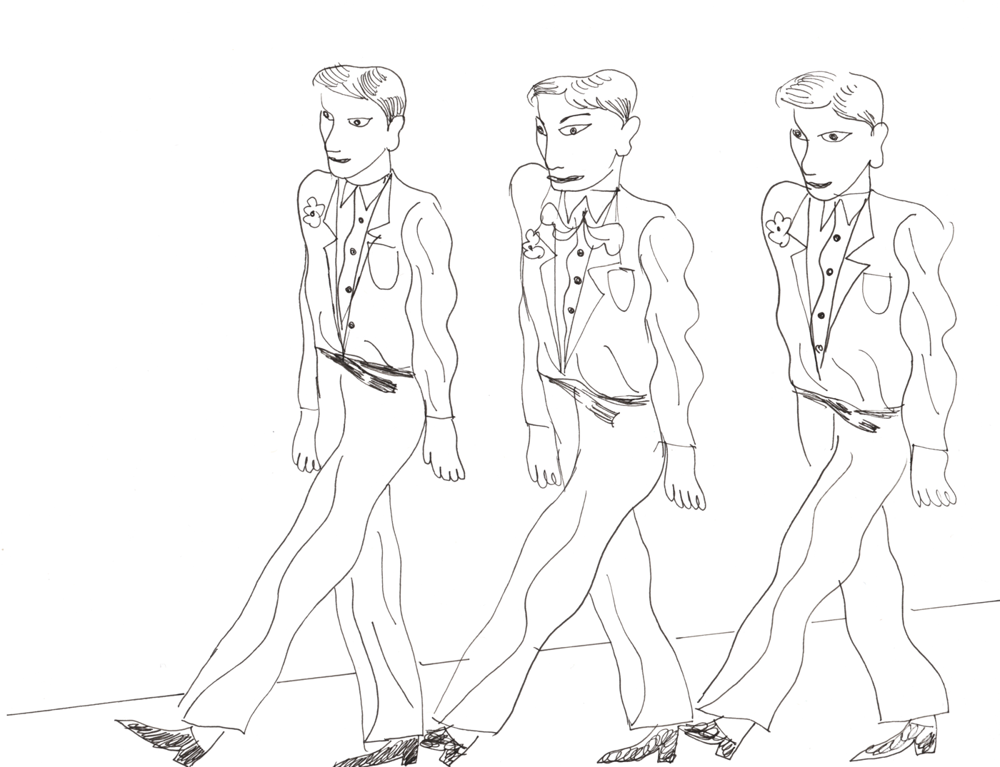
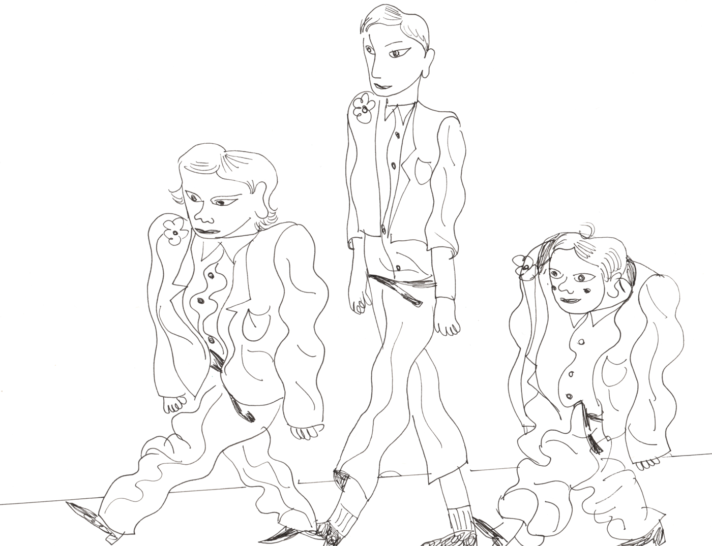

<!--
Lecture 12B (Wednesday). Multiple linear regression with babies (lm) and
bikes (stan_glm), then adjusted R-squared, overfitting, and training and
testing. The jacket images are reused from the 10b-extra statistical learning
activity.
-->

```{r}
#| echo: false
#| message: false
library(tidyverse)
library(openintro)
library(broom)
library(patchwork)
library(rstanarm)
library(bayesrules)
library(rsample)
options(scipen = 999)

source("R/plot-normal.R")

green <- hds_colors[["green"]]
pink <- hds_colors[["pink"]]

theme_set(theme_minimal(base_size = 22))

f1 <- function(x) sprintf("%.1f", x)
f2 <- function(x) sprintf("%.2f", x)
f3 <- function(x) sprintf("%.3f", x)
f0 <- function(x) format(round(x), big.mark = ",")
fmt_p <- function(p) if (p == 1) "more than 0.9999" else if (p == 0) "less than 0.0001" else sprintf("%.2f", p)
```

```{r}
#| echo: false
#| cache: true
# Bayesian models (cached: they take a while)
bike_model_2 <- stan_glm(rides ~ temp_feel + weekend, data = bikes,
                         prior_intercept = normal(5000, 1000),
                         prior = normal(c(100, 0), c(40, 1000)),
                         seed = 84735, refresh = 0)

set.seed(84735)
bike_split <- initial_split(bikes, prop = 0.8)
bike_train <- training(bike_split)
bike_test <- testing(bike_split)
bike_train_1 <- stan_glm(rides ~ temp_feel, data = bike_train,
                         prior_intercept = normal(5000, 1000),
                         prior = normal(100, 40),
                         seed = 84735, refresh = 0)
bike_train_2 <- stan_glm(rides ~ temp_feel + weekend, data = bike_train,
                         prior_intercept = normal(5000, 1000),
                         prior = normal(c(100, 0), c(40, 1000)),
                         seed = 84735, refresh = 0)
```

# More than one explanatory variable {.inverse background-color="#A51C30"}

## Last week

Two separate models for birth weight (in ounces):

```{r}
#| echo: false
babies <- babies |> drop_na()
r2_g <- glance(lm(bwt ~ gestation, data = babies))$r.squared
```

- `bwt ~ gestation`: each extra day of gestation, about 0.46 ounces heavier.
- `bwt ~ smoke`: babies of mothers who smoked, about 8.9 ounces lighter.

. . .

On Monday, we saw that gestation explains only about `r round(100 * r2_g)`% of the variability in birth weight.

. . .

Can we use __both__ gestation and smoking in __one__ model?

## Multiple linear regression

$$y_i = \beta_0 + \beta_1 x_{1i} + \beta_2 x_{2i} + \dots + \beta_k x_{ki} + \epsilon_i$$

- $k$ explanatory variables: $x_1, x_2, \dots, x_k$
- one slope for each explanatory variable

. . .

For birth weight:

$$\text{bwt}_i = \beta_0 + \beta_1 \text{gestation}_i + \beta_2 \text{smoke}_i + \epsilon_i$$

## Missing values

Some babies are missing some variables. Today we compare models with different variables, so every model should use the __same__ babies.

```{r}
#| eval: false
babies <- babies |>
  drop_na()
```

```{r}
#| echo: false
n_babies <- nrow(babies)
```

`drop_na()` from the {tidyr} package (part of the tidyverse) keeps only the rows with no missing values. `r format(n_babies, big.mark = ",")` of the 1,236 babies are left.

## Fitting the model

In R, we add explanatory variables with `+`.

```{r}
model_gs <- lm(bwt ~ gestation + smoke, data = babies)
tidy(model_gs)
```

```{r}
#| echo: false
gs <- tidy(model_gs)
g0 <- round(gs$estimate[1], 2)
g1 <- round(gs$estimate[2], 3)
g2 <- round(gs$estimate[3], 2)
```

$$\widehat{\text{bwt}} = `r g0` + `r g1` \times \text{gestation} - `r abs(g2)` \times \text{smoke}$$

## Two parallel lines

`smoke` is 0 or 1, so the model is two lines with the same slope:

::: columns
::: {.column width="40%"}
- Did not smoke (smoke = 0): $\widehat{\text{bwt}} = `r g0` + `r g1` \times \text{gestation}$
- Smoked (smoke = 1): $\widehat{\text{bwt}} = (`r g0` - `r abs(g2)`) + `r g1` \times \text{gestation}$
:::

::: {.column width="60%"}
```{r}
#| echo: false
#| fig-height: 5.4
#| fig-width: 8
#| fig-alt: !expr glue::glue("Scatterplot of birth weight against gestation, with points colored by whether the mother smoked. Two parallel lines are drawn; the line for mothers who did not smoke is about {abs(g2)} ounces above the line for mothers who smoked.")
babies |>
  mutate(smoke = factor(smoke, labels = c("did not smoke", "smoked"))) |>
  ggplot(aes(gestation, bwt, color = smoke)) +
  geom_point(alpha = 0.3) +
  geom_abline(intercept = g0, slope = g1, color = green, linewidth = 1.5) +
  geom_abline(intercept = g0 + g2, slope = g1, color = pink, linewidth = 1.5) +
  scale_color_manual(values = c(green, pink)) +
  coord_cartesian(xlim = c(220, 340)) +
  labs(color = NULL) +
  theme(legend.position = "bottom")
```
:::
:::

## Interpreting the slopes

Each slope is interpreted __holding the other variables constant__.

. . .

- __gestation:__ for babies whose mothers have the same smoking status, each additional day of gestation is associated with `r g1` ounces higher birth weight, on average.

. . .

- __smoke:__ for babies with the same gestation, babies of mothers who smoked are expected to weigh `r abs(g2)` ounces less, on average, than babies of mothers who did not smoke.

## Your turn

::: {.stat-callout .exercise}
**Exercise**

$$\widehat{\text{bwt}} = `r g0` + `r g1` \times \text{gestation} - `r abs(g2)` \times \text{smoke}$$

Predict the birth weight of a baby born after 280 days whose mother

a. did not smoke.
b. smoked.
c. What is the difference between (a) and (b)? Where is it in the model?
:::

## The smoking slope changed

```{r}
#| echo: false
s_only <- tidy(lm(bwt ~ smoke, data = babies))$estimate[2]
```

| Model | Slope of `smoke` |
|---|---|
| `bwt ~ smoke` | `r f2(s_only)` |
| `bwt ~ gestation + smoke` | `r f2(g2)` |

: Slope of smoke with and without gestation in the model

<small>Both models are fit to the same `r format(n_babies, big.mark = ",")` babies (after `drop_na()`), so the first slope is a little different from last week's.</small>

::: {.stat-callout .discussion}
**Discussion**

Why might the slope of `smoke` change when gestation is in the model? (Hint: do mothers who smoke tend to have shorter or longer pregnancies?)
:::

## Inference for each slope

```{r}
confint(model_gs)
```

```{r}
#| echo: false
ci_gs <- confint(model_gs)
```

::: {.stat-callout .exercise}
**Exercise**

Interpret the 95% confidence interval for the slope of `smoke`. Is there convincing evidence that smoking is associated with birth weight, after taking gestation into account?
:::

## Still not causal

"Holding gestation constant" sounds like an experiment, but it is not one.

. . .

- `babies` is still an __observational__ study: nobody assigned mothers to smoke or not.
- Adding gestation to the model accounts for __one__ other variable. Mothers who smoked and mothers who did not could still differ in many ways that are not in the model.

. . .

So we can say smoking is __associated__ with lower birth weight, after taking gestation into account. From this model alone, we __cannot__ conclude that smoking __causes__ lower birth weight.

# Bayesian multiple linear regression {.inverse background-color="#A51C30"}

## Bikeshare, again

Last week: `rides ~ temp_feel` and `rides ~ weekend`, separately. Now both:

$$Y_i \mid \beta_0, \beta_1, \beta_2, \sigma \sim N(\beta_0 + \beta_1 \text{temp\_feel}_i + \beta_2 \text{weekend}_i, \ \sigma^2)$$

. . .

We need a prior for each parameter. We keep the priors from last week:

| Parameter | Prior |
|---|---|
| Centered intercept (an average temperature weekday) | $N(5000, 1000^2)$ |
| $\beta_1$, `temp_feel` | $N(100, 40^2)$ |
| $\beta_2$, `weekend` | $N(0, 1000^2)$ |

: Priors for the bikeshare model

## Fitting the model

`prior` takes one normal distribution for each slope, in the same order as the variables.

```{r}
#| eval: false
bike_model_2 <- stan_glm(rides ~ temp_feel + weekend, data = bikes,
                         prior_intercept = normal(5000, 1000),
                         prior = normal(c(100, 0), c(40, 1000)),
                         seed = 84735, refresh = 0)
```

```{r}
bike_draws_2 <- as.data.frame(bike_model_2)
head(bike_draws_2, 3)
```

Each row is one plausible set of $(\beta_0, \beta_1, \beta_2, \sigma)$.

## Posterior plausible lines

```{r}
#| echo: false
#| fig-height: 5
#| fig-width: 12
#| fig-align: center
#| fig-alt: "Scatterplot of rides against temperature with points colored by weekday or weekend. Fifty pink posterior lines for weekdays sit above fifty green posterior lines for weekends; within each group the lines are close together and all go up with temperature."
set.seed(84735)
lines_2 <- bike_draws_2 |> slice_sample(n = 50)
ggplot(bikes, aes(temp_feel, rides)) +
  geom_point(aes(color = weekend), alpha = 0.4) +
  geom_abline(data = lines_2, aes(intercept = `(Intercept)`, slope = temp_feel),
              color = pink, alpha = 0.3) +
  geom_abline(data = lines_2, aes(intercept = `(Intercept)` + weekendTRUE, slope = temp_feel),
              color = green, alpha = 0.3) +
  scale_color_manual(values = c(`FALSE` = pink, `TRUE` = green),
                     labels = c("weekday", "weekend"), name = NULL) +
  scale_y_continuous(labels = scales::comma)
```

Two sets of parallel lines: weekdays (pink) and weekends (green).

## Posterior summaries

```{r}
bike_draws_2 |>
  summarize(posterior_mean_b1 = mean(temp_feel),
            posterior_lower_b1 = quantile(temp_feel, 0.025),
            posterior_upper_b1 = quantile(temp_feel, 0.975))
bike_draws_2 |>
  summarize(posterior_mean_b2 = mean(weekendTRUE),
            posterior_lower_b2 = quantile(weekendTRUE, 0.025),
            posterior_upper_b2 = quantile(weekendTRUE, 0.975))
```

```{r}
#| echo: false
b2_mean <- mean(bike_draws_2$weekendTRUE)
b2_ci <- quantile(bike_draws_2$weekendTRUE, c(0.025, 0.975))
b2_neg <- mean(bike_draws_2$weekendTRUE < 0)
```

## Your turn

::: {.stat-callout .exercise}
**Exercise**

a. Interpret the posterior mean of $\beta_2$ (`weekendTRUE`) in context. Remember: holding temperature constant.
b. Interpret the 95% posterior credible interval for $\beta_2$.
c. What code would find the posterior probability that $\beta_2 < 0$?
:::

. . .

```{r}
bike_draws_2 |>
  summarize(posterior_prob_negative = mean(weekendTRUE < 0))
```

## How wrong is the new model?

The same tools as on Monday. Each row of `bike_draws_2` gives a plausible line for weekdays, one for weekends, and $\sigma$. `pp_check()` simulates 50 data sets and compares them with the real rides.

```{r}
#| fig-height: 3.6
#| fig-width: 10
#| out-width: 85%
#| fig-align: center
#| fig-alt: "Posterior predictive check for the model of rides with temperature and weekend. A dark curve shows the distribution of the real rides; 50 light curves show the distributions of 50 simulated data sets. The light curves have about the same center and spread as the dark curve."
pp_check(bike_model_2)
```

Do the simulated data sets look like the real data?

# How many variables? {.inverse background-color="#A51C30"}

## More explanatory variables

```{r}
model_all <- lm(bwt ~ gestation + smoke + parity + age + height + weight,
                data = babies)
tidy(model_all) |>
  select(term, estimate, p.value)
```

<small>`parity`: 0 for a first pregnancy, 1 otherwise. `age`: mother's age (years). `height`: mother's height (inches). `weight`: mother's pre-pregnancy weight (pounds).</small>

## More explanatory variables

```{r}
#| echo: false
ht <- tidy(model_all) |> filter(term == "height")
```

::: {.stat-callout .exercise}
**Exercise**

a. Interpret the slope of `height` (`r f3(ht$estimate)`) in context.
b. Which variable does not seem to be associated with birth weight, after taking the others into account?
:::

## $R^2$ never goes down

```{r}
#| echo: false
set.seed(84735)
babies_random <- babies |> mutate(random = rnorm(n()))
model_random <- lm(bwt ~ gestation + smoke + parity + age + height + weight + random,
                   data = babies_random)
model_g <- lm(bwt ~ gestation, data = babies)
r2_tab <- tibble(model = c("gestation", "gestation + smoke",
                           "six: gestation, smoke, parity, age, height, weight",
                           "the same six + random"),
                 fit = list(model_g, model_gs, model_all, model_random)) |>
  mutate(r2 = map_dbl(fit, ~ glance(.x)$r.squared),
         adj = map_dbl(fit, ~ glance(.x)$adj.r.squared))
```

| Explanatory variables | $R^2$ |
|---|---|
| `r r2_tab$model[1]` | `r f3(r2_tab$r2[1])` |
| `r r2_tab$model[2]` | `r f3(r2_tab$r2[2])` |
| `r r2_tab$model[3]` | `r f3(r2_tab$r2[3])` |
| `r r2_tab$model[4]` | `r f3(r2_tab$r2[4])` |

: R-squared for four models of birth weight

. . .

`random` is a column of __simulated random numbers__: `mutate(random = rnorm(n()))`. It has nothing to do with birth weight, but $R^2$ still went up!

. . .

Adding a variable can never make $R^2$ smaller. So $R^2$ cannot tell us whether a variable is worth adding.

## Adjusted $R^2$

__Adjusted $R^2$__ has a penalty for each of the $k$ explanatory variables ($n$: number of observations):

$$R^2_{adj} = 1 - \frac{\sum (y_i - \hat{y}_i)^2 / (n - k - 1)}{\sum (y_i - \bar{y})^2 / (n - 1)}$$

```{r}
glance(model_all) |>
  select(r.squared, adj.r.squared)
```

It goes up only if a new variable helps more than we would expect by chance. Use it to __compare__ models.

## Adjusted $R^2$

| Explanatory variables | $R^2$ | Adj. $R^2$ |
|---|---|---|
| `r r2_tab$model[1]` | `r f3(r2_tab$r2[1])` | `r f3(r2_tab$adj[1])` |
| `r r2_tab$model[2]` | `r f3(r2_tab$r2[2])` | `r f3(r2_tab$adj[2])` |
| `r r2_tab$model[3]` | `r f3(r2_tab$r2[3])` | `r f3(r2_tab$adj[3])` |
| `r r2_tab$model[4]` | `r f3(r2_tab$r2[4])` | `r f3(r2_tab$adj[4])` |

: R-squared and adjusted R-squared for four models of birth weight

::: {.stat-callout .exercise}
**Exercise**

Which model would you choose? Why?
:::

# Training and testing {.inverse background-color="#A51C30"}

## Why do we fit models?

Often, to make predictions for __new__ data: babies who are not in our data yet.

. . .

So far, we evaluated each model on the __same__ data we used to fit it. That is like a clothing store checking whether a jacket fits... on the model it was tailored for.

## A jacket made for its models

::: columns
::: {.column width="50%"}
```{r}
#| echo: false
#| fig-alt: Illustration of 3 male looking models on a runway in exact same jacket, belt, pants, and shoes.

```
__Training:__ fits perfectly.
:::

::: {.column width="50%"}
```{r}
#| echo: false
#| fig-alt: The same jacket and pants worn by three different people with very different body types. The middle figure is tall, hence the jacket arms and pants legs are too short for them, the righ figure is short and the jacket arms and pants legs are too large for them.

```
__Testing:__ new people, not a good fit.
:::
:::

## Overfitting

```{r}
#| echo: false
set.seed(84735)
small <- babies |>
  filter(between(gestation, 255, 305)) |>
  slice_sample(n = 15)
rest <- babies |>
  filter(!case %in% small$case,
         between(gestation, min(small$gestation), max(small$gestation)))
m_line <- lm(bwt ~ gestation, data = small)
m_wiggly <- lm(bwt ~ poly(gestation, 9), data = small)
rmse <- function(m, d) sqrt(mean((d$bwt - predict(m, d))^2))
grid <- tibble(gestation = seq(min(small$gestation), max(small$gestation), length.out = 400)) |>
  mutate(line = predict(m_line, pick(everything())),
         wiggly = predict(m_wiggly, pick(everything())))
```

We fit two models to __`r nrow(small)` babies__: a straight line and a very wiggly curve.

```{r}
#| echo: false
#| fig-height: 4.4
#| fig-width: 13
#| fig-align: center
#| fig-alt: !expr glue::glue("Two scatterplots of the same 15 babies, birth weight against gestation. On the left, a straight line through the points. On the right, a wiggly curve that goes up and down to pass close to almost every point. The training RMSE is {f1(rmse(m_line, small))} ounces for the line and {f1(rmse(m_wiggly, small))} ounces for the wiggly curve.")
yl <- c(60, 180)
p_line <- ggplot(small, aes(gestation, bwt)) +
  geom_line(data = grid, aes(y = line), color = green, linewidth = 1.3) +
  geom_point(size = 3) +
  coord_cartesian(ylim = yl) +
  labs(title = paste0("Line: training RMSE = ", f1(rmse(m_line, small))))
p_wig <- ggplot(small, aes(gestation, bwt)) +
  geom_line(data = grid, aes(y = wiggly), color = pink, linewidth = 1.3) +
  geom_point(size = 3) +
  coord_cartesian(ylim = yl) +
  labs(title = paste0("Wiggly: training RMSE = ", f1(rmse(m_wiggly, small))))
(p_line | p_wig) & theme(plot.title = element_text(size = 20))
```

Which model looks better?

## Overfitting

Now we use both models to predict the __other `r format(nrow(rest), big.mark = ",")` babies__ (in the same range of gestation).

```{r}
#| echo: false
#| fig-height: 4.4
#| fig-width: 13
#| fig-align: center
#| fig-alt: !expr glue::glue("The same two models drawn over all the other babies, shown as light gray points. The straight line goes through the middle of the gray cloud. The wiggly curve swings far above and below the cloud. The testing RMSE is {f1(rmse(m_line, rest))} ounces for the line and {f1(rmse(m_wiggly, rest))} ounces for the wiggly curve.")
yl2 <- c(20, 220)
p_line2 <- ggplot(rest, aes(gestation, bwt)) +
  geom_point(color = "gray60", alpha = 0.4) +
  geom_line(data = grid, aes(y = line), color = green, linewidth = 1.3) +
  coord_cartesian(ylim = yl2) +
  labs(title = paste0("Line: testing RMSE = ", f1(rmse(m_line, rest))))
p_wig2 <- ggplot(rest, aes(gestation, bwt)) +
  geom_point(color = "gray60", alpha = 0.4) +
  geom_line(data = grid, aes(y = wiggly), color = pink, linewidth = 1.3) +
  coord_cartesian(ylim = yl2) +
  labs(title = paste0("Wiggly: testing RMSE = ", f1(rmse(m_wiggly, rest))))
(p_line2 | p_wig2) & theme(plot.title = element_text(size = 20))
```

The wiggly model learned the __noise__ in its 15 babies, not the pattern. It is __overfit__.

## Training and testing data

1. Randomly split the data into __training__ data (often 80%) and __testing__ data (20%).
2. Fit the model with the training data only.
3. Predict the testing data and calculate the RMSE.

. . .

`initial_split()`, `training()`, and `testing()` are from the {rsample} package (part of the tidymodels family, which works well with the tidyverse).

```{r}
set.seed(84735)
babies_split <- initial_split(babies, prop = 0.8)
babies_train <- training(babies_split)
babies_test <- testing(babies_split)
```

## Fit on training, evaluate on testing

```{r}
model_train <- lm(bwt ~ gestation + smoke, data = babies_train)

babies_test |>
  mutate(prediction = predict(model_train, newdata = babies_test)) |>
  summarize(test_rmse = sqrt(mean((bwt - prediction)^2)))
```

`predict()` from Monday: here `newdata` is the whole testing data.

## Comparing models on testing data

```{r}
#| echo: false
test_rmse <- function(formula) {
  m <- lm(formula, data = babies_train)
  c(train = sqrt(mean(residuals(m)^2)),
    test = sqrt(mean((babies_test$bwt - predict(m, newdata = babies_test))^2)))
}
tt <- list(bwt ~ gestation, bwt ~ gestation + smoke,
           bwt ~ gestation + smoke + parity + age + height + weight) |>
  map(test_rmse)
```

| Explanatory variables | Training RMSE | Testing RMSE |
|---|---|---|
| gestation | `r f2(tt[[1]]["train"])` | `r f2(tt[[1]]["test"])` |
| gestation + smoke | `r f2(tt[[2]]["train"])` | `r f2(tt[[2]]["test"])` |
| gestation + smoke + parity + age + height + weight | `r f2(tt[[3]]["train"])` | `r f2(tt[[3]]["test"])` |

: Training and testing RMSE (ounces) for three models of birth weight

::: {.stat-callout .exercise}
**Exercise**

Which model predicts new babies best? Do the extra variables lead to overfitting here?
:::

## Occam's razor

> Among models that explain the data about equally well, choose the __simpler__ one.

This principle of __parsimony__ is called __Occam's razor__, after William of Ockham, a 14th-century philosopher.

. . .

Why prefer a simpler model?

- It is easier to interpret and explain.
- To predict for a new baby, we need to collect fewer variables.
- It is less likely to be overfit.

## Occam's razor: babies

| Explanatory variables | Testing RMSE |
|---|---|
| gestation + smoke | `r f2(tt[[2]]["test"])` |
| all six variables | `r f2(tt[[3]]["test"])` |

: Testing RMSE (ounces) for two models of birth weight

::: {.stat-callout .discussion}
**Discussion**

The six-variable model's testing RMSE (`r f2(tt[[3]]["test"])`) is only `r f2(tt[[2]]["test"] - tt[[3]]["test"])` ounces lower than the model with gestation and smoking (`r f2(tt[[2]]["test"])`), but it needs four more variables. Which model would you choose? Does it depend on what the model is for?
:::

## Training and testing: Bayesian

Same idea: fit `stan_glm()` on the training data only. Then, as on Monday, check how many days in the __testing__ data fall inside their 95% posterior predictive intervals.

```{r}
#| eval: false
set.seed(84735)
bike_split <- initial_split(bikes, prop = 0.8)
bike_train <- training(bike_split)
bike_test <- testing(bike_split)
bike_train_2 <- stan_glm(rides ~ temp_feel + weekend, data = bike_train,
                         prior_intercept = normal(5000, 1000),
                         prior = normal(c(100, 0), c(40, 1000)),
                         seed = 84735, refresh = 0)
```

```{r}
set.seed(84735)
prediction_summary(bike_train_2, data = bike_test)
```

<small>`data = bike_test`: the model never saw these days.</small>

## Training and testing: Bayesian

```{r}
#| echo: false
set.seed(84735)
ps1 <- prediction_summary(bike_train_1, data = bike_test)
set.seed(84735)
ps2 <- prediction_summary(bike_train_2, data = bike_test)
```

| Explanatory variables | `mae` (rides) | `within_50` | `within_95` |
|---|---|---|---|
| temp_feel | `r f0(ps1$mae)` | `r f2(ps1$within_50)` | `r f2(ps1$within_95)` |
| temp_feel + weekend | `r f0(ps2$mae)` | `r f2(ps2$within_50)` | `r f2(ps2$within_95)` |

: Posterior prediction on the testing data for two Bayesian bikeshare models

::: {.stat-callout .exercise}
**Exercise**

Which model predicts new days better? Are the posterior predictive intervals about right for both models?
:::

## Cross-validation

::: {.stat-callout .note-tip}
**Note**

With one split, the result depends on which rows happened to land in the testing data. *Cross-validation* repeats the split many times (each row gets a turn in the testing data) and averages the results. You will see it in more advanced classes.
:::

## Summary {.smaller}

- Multiple linear regression: $y_i = \beta_0 + \beta_1 x_{1i} + \dots + \beta_k x_{ki} + \epsilon_i$. In R: `lm(y ~ x1 + x2, ...)` or `stan_glm(y ~ x1 + x2, ...)`, with one prior per slope: `prior = normal(c(...), c(...))`.
- Each slope is interpreted __holding the other variables constant__. A slope can change when other variables are added. With observational data, this is still an association, not causation.
- $R^2$ never goes down when we add a variable, even a random one. __Adjusted $R^2$__ penalizes each extra variable and is used to compare models.
- A model that fits its own data very closely can be __overfit__: it does not generalize to new data.
- __Occam's razor:__ among models that explain the data about equally well, choose the simpler one.
- To evaluate predictions honestly: split the data into __training__ and __testing__ data and fit on the training data. Frequentist: calculate the RMSE on the testing data. Bayesian: check the testing data against the posterior predictive intervals with `prediction_summary()`.
